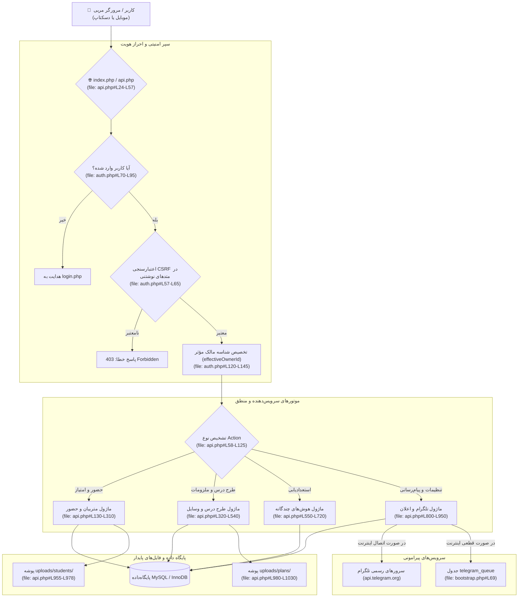

# ROOT MASTER ARCHITECTURE SPECIFICATION (ROOT_MASTER.md)
# سامانه جامع مدیریت هوشمند کلاس و جلسات تربیتی (چهارشنبه جلسه)

> **سند والد ریشه (Root Master Parent Document)**  
> **پروتکل مرجع:** پروتکل جامع معماری مستر و حافظه شناختی مشترک (UMAC-P)  
> **مسیر سند:** `docs/ai/ROOT_MASTER.md`  
> **وضعیت:** ACTIVE & BINDING  
> **آخرین بازبینی:** 2026-10-17  
> **نگهدارنده ارشد:** Chief Systems Architect & AI Engineering Custodians  

---

## ۱. چشم‌انداز، هویت و ارکان بیزینس سیستم (Vision & Core Mission)

سامانه **«چهارشنبه جلسه» (CharShanbeJalase)** یک پلتفرم بومی، مستقل از اینترنت خارجی و یکپارچه برای مدیریت کلاس‌ها و گروه‌های تربیتی/آموزشی است که فرآیندهای زیر را به طور خودکار، دقیق و بلادرنگ مدیریت می‌کند:
1. **پایش دقیق حضور و غیاب و امتیازدهی:** ثبت جلسات، محاسبه تاخیر (بر حسب دقیقه)، غیبت، موجه، حضور و امتیازات سیستمی و دستی.
2. **برنامه‌ریزی جامع طرح درس (Curriculum Planning):** تفکیک برنامه‌ها به سین زمان‌بندی، بخش‌های متنوع (بازی، داستان، یاد حضرت، اردو، آزاد) و استخراج خودکار ملزومات خرید.
3. **استعدادیابی و هوش‌های هشت‌گانه گاردنر (Multiple Intelligences - MI):** ثبت مشاهدات رفتاری متربیان در زمینه‌ها و بسترهای مختلف و ترسیم پروفایل رشد.
4. **پیام‌رسانی و اتوماسیون تلگرام:** اطلاع‌رسانی فوری خریدهای ضروری به مربیان و مدیران با دکمه‌های شیشه‌ای تایید خرید (`InlineKeyboard`) و وبهوک دوطرفه.
5. **استقلال کامل از سرویس‌های آنلاین و CDN:** بدون وابستگی به Google Apps Script، CDNهای خارجی، Chart.js آنلاین یا فونت‌های اینترنتی؛ آماده کار در شبکه محلی و XAMPP.

---

## ۲. پشته فنی و نیازمندی‌های زیرساخت (Technology Stack)

| لایه | فناوری انتخابی | دلایل معماری و پایداری |
|---|---|---|
| **وب‌سرور و ران‌تایم** | Apache + PHP 8.x (محیط محلی XAMPP / سرور اختصاصی) | پایداری بالا، دسترسی مستقیم، بدون وابستگی به Node.js سنگین |
| **پایگاه‌داده** | MySQL 8.0+ / MariaDB (موتور InnoDB با یونیکد `utf8mb4_unicode_ci`) | تراکنش‌های ACID، کلیدهای خارجی با CASCADE، پشتیبانی از فیلدهای JSON |
| **معماری بک‌اند** | ساختار روتر ماژولار مبتنی بر توابع امن و PDO آماده (`Prepared Statements`) | سرعت پردازش بالا، مقاومت کامل در برابر SQL Injection و امنیت نشست |
| **لایه فرانت‌اند** | HTML5 معنایی + CSS3 ماژولار + وانیلا جاوااسکریپت (Vanilla ES6+) | استقلال ۱۰۰٪ از کتابخانه‌های حجیم، انطباق لمسی با موبایل، سرعت لود زیر ۵۰ میلی‌ثانیه |
| **رسم نمودارها** | رندرر اختصاصی توکار مبتنی بر Canvas و SVG بدون هیچ CDN خارجی | حذف خطای معروف `Chart is not defined` در زمان قطعی اینترنت |
| **آفلاین و کش** | PWA Service Worker (`sw.js`) | ذخیره منابع استاتیک و پایداری تجربه کاربری در نوسانات شبکه |
| **پیام‌رسان** | Telegram Bot API با قابلیت صف آفلاین (`telegram_queue`) | ارسال پیام با فالبک، پروکسی محلی و بازیابی در صورت قطع اینترنت |

---

## ۳. نقشه کلان ساختار دایرکتوری‌ها (System Directory Blueprint)

```
c:\xampp\htdocs\CharShanbeJalase/
├── docs/ai/                            # [حافظه پایدار مستر بر اساس UMAC-P]
│   ├── ROOT_MASTER.md                  # همین سند ریشه کلان
│   ├── PROJECT_STATE.md                # حافظه زنده آخرین وضعیت و امضای هوش‌ها
│   ├── CHANGELOG.md                    # تاریخچه لاگ تغییرات فنی
│   ├── DECISIONS.md                    # دفتر تصمیمات قطعی معمارانه (DEC-XXXX)
│   ├── BACKLOG.md                      # کارهای باز و مسیر ریدیزاین UI/UX
│   ├── INDEX.md                        # رادار و شاخص خطوط و نمادهای کلیدی
│   ├── domains/                        # اسناد والد دامنه‌های پنج‌گانه
│   │   ├── AUTH_AND_SECURITY.md        # دامنه احراز هویت، نشست و CSRF
│   │   ├── STUDENTS_AND_ATTENDANCE.md  # دامنه متربیان، حضور و امتیاز
│   │   ├── CURRICULUM_AND_ACTIVITIES.md# دامنه طرح درس، سین، ملزومات و ابزارها
│   │   ├── INTELLIGENCE_MI_SYSTEM.md   # دامنه هوش هشت‌گانه و استعدادیابی
│   │   └── INFRASTRUCTURE_AUTOMATION.md# دامنه تلگرام، بکاپ و سرویس ورکر
│   └── masters/                        # اسناد فرزند اجرایی
│       ├── MASTER_01_SYSTEM_BASELINE.md# سند تثبیت و کالبدشکافی وضعیت موجود
│       └── MASTER_02_UI_UX_REDESIGN.md # سند بازطراحی جامع رابط و تجربه کاربری
├── assets/                             # دارایی‌های استاتیک محلی (فونت، استایل، آیکن)
│   ├── app.css                         # استایل‌شیت اصلی برنامه
│   ├── default-avatar.svg              # آواتار پیش‌فرض محلی آفلاین
│   ├── favicon.svg                     # آیکون بردار تب مرورگر
│   └── fonts/                          # قلم استاندارد وزیرمتن (بدون CDN)
├── parts/                              # کامپوننت‌های فرانت‌اند
│   ├── api-client.js                   # کلاینت ارتباط با ای‌پی‌آی
│   ├── app.js                          # منطق فرم‌ها و اکشن‌ها
│   ├── chart.js                        # موتور رسم نمودار محلی Canvas
│   ├── mi-new.js                       # ماژول رابط کاربری هوش چندگانه
│   └── spotlight.js                    # جستجوی سریع
├── uploads/                            # بارگذاری فایل‌های واقعی کاربران
│   ├── students/                       # عکس‌های پروفایل محلی دانش‌آموزان
│   └── plans/                          # پیوست‌های چندرسانه‌ای طرح درس‌ها
├── data/                               # داده‌های پشتیبان CSV خروجی گوگل شیت
├── admin.php                           # پنل مدیریت مدیر کل
├── api.php                             # روتر متمرکز درخواست‌های API
├── auth.php                            # نشست، ورود/خروج و کنترل دسترسی
├── backup.php                          # ابزار صادرات دیتابیس (SQL و JSON)
├── bootstrap.php                       # هسته دیتابیس، مایگریشن و توابع پایه
├── config.php                          # پیکربندی اتصال به پایگاه‌داده
├── cron.php                            # وظایف دوره‌ای اعلان‌های روزانه
├── database.sql                        # اسکریپت ساختار پایگاه‌داده
├── import.php                          # واردکننده فایل‌های CSV قدیمی
├── index.php                           # نقطه ورود اصلی داشبورد وب
├── sw.js                               # سرویس ورکر آفلاین PWA
└── webhook.php                         # دریافت‌کننده وبهوک‌های تلگرام
```

---

## ۴. دیاگرام کلان جریان داده و معماری سیستم (High-Level Architecture Diagram)



---

## ۵. منشور نبایدها و خطوط قرمز کلان سیستم (System Invariants & Prohibitions)

> ⛔ **هرگونه تخطی از خطوط قرمز زیر در کل چرخه توسعه اکیداً ممنوع است:**

1. **ممنوعیت وابستگی به اینترنت در فرانت‌اند:**
   - نباید هیچ فایل CSS، JS، فونت یا تصویری از CDN (مانند cdnjs, jsdelivr, unpkg, googleapis) فراخوانی شود. تمامی فونت‌ها و کتابخانه‌ها باید به صورت لوکال در `assets/` مستقر باشند.
2. **ممنوعیت تخریب و جهش ساختار داده‌های موجود:**
   - جدول‌های موجود (`students`, `attendance_sessions`, `attendance_records`, `plans`, `essentials`, `mi_logs`, `notes`, `settings`) نباید بدون سند رسمی معماری و مایگریشن اتمیک حذف یا بازنویسی شوند.
3. **ممنوعیت ذخیره مستقیم رمز و توکن در گیت:**
   - توکن ربات تلگرام و رمزهای عبور کاربران باید تنها در جدول `settings` یا متغیرهای محافظت‌شده نگهداری شوند و هیچ توکنی نباید در کدهای عمومی ثبت شود.
4. **ممنوعیت تبدیل اعداد به صورت ناسازگار:**
   - محاسبات زمان تاخیر (`late_minutes`) و امتیازات باید در سطح بک‌اند همیشه به صورت داده عددی استاندارد پردازش شوند و تبدیل ارقام به فارسی صرفاً در لایه ارائه به کاربر (Presentation Layer) انجام گیرد.
5. **ممنوعیت شکستن معماری چندکاربره (Multi-Tenancy):**
   - تمامی کوئری‌های واکشی و درج داده باید مشروط به `owner_id = apiOwner()` باشند تا اطلاعات مربیان مختلف با یکدیگر تداخل پیدا نکند (`api.php#L9-L11`).

---

## ۶. پیوند به اسناد دامنه‌ها و فرزندان اجرایی

- **اسناد دامنه‌ها (Domain Masters):**
  - [دامنه احراز هویت، امنیت و نشست](file:///c:/xampp/htdocs/CharShanbeJalase/docs/ai/domains/AUTH_AND_SECURITY.md)
  - [دامنه متربیان، حضور و غیاب و محاسبات امتیاز](file:///c:/xampp/htdocs/CharShanbeJalase/docs/ai/domains/STUDENTS_AND_ATTENDANCE.md)
  - [دامنه طرح درس، ملزومات کلاسی و آرشیو](file:///c:/xampp/htdocs/CharShanbeJalase/docs/ai/domains/CURRICULUM_AND_ACTIVITIES.md)
  - [دامنه هوش‌های هشت‌گانه گاردنر و استعدادیابی](file:///c:/xampp/htdocs/CharShanbeJalase/docs/ai/domains/INTELLIGENCE_MI_SYSTEM.md)
  - [دامنه اتوماسیون، پیام‌رسانی و پشتیبان‌گیری](file:///c:/xampp/htdocs/CharShanbeJalase/docs/ai/domains/INFRASTRUCTURE_AUTOMATION.md)
- **اسناد فرزند اجرایی (Child Task Masters):**
  - [MASTER-01: کالبدشکافی وضعیت موجود و انتقال از نسخه قدیمی](file:///c:/xampp/htdocs/CharShanbeJalase/docs/ai/masters/MASTER_01_SYSTEM_BASELINE.md)
  - [MASTER-02: بازطراحی بنیادین رابط و تجربه کاربری (UI/UX Redesign)](file:///c:/xampp/htdocs/CharShanbeJalase/docs/ai/masters/MASTER_02_UI_UX_REDESIGN.md)
  - [MASTER-03: زبان طراحی شیشه‌ای مایع آیفون (iOS Liquid Glass)](file:///c:/xampp/htdocs/CharShanbeJalase/docs/ai/masters/MASTER_03_IOS_LIQUID_GLASS.md)
  - [MASTER-04: معماری صفحات ماژولار و تفکیک هدر و ناوبری](file:///c:/xampp/htdocs/CharShanbeJalase/docs/ai/masters/MASTER_04_MODULAR_PAGES_ARCHITECTURE.md)
  - [MASTER-05: فرمول امتیازدهی تاخیر و مدل تصاعدی انضباط](file:///c:/xampp/htdocs/CharShanbeJalase/docs/ai/masters/MASTER_05_TARDINESS_SCORING_FORMULA.md)
  - [MASTER-06: ثبت علت غیبت و گزارش پیامکی اولیا](file:///c:/xampp/htdocs/CharShanbeJalase/docs/ai/masters/MASTER_06_ABSENCE_REASON_RECORDING.md)
  - [MASTER-07: سامانه جامع استعدادیابی و ارزیابی چندمنبعی هوش‌های چندگانه](file:///c:/xampp/htdocs/CharShanbeJalase/docs/ai/masters/MASTER_07_MULTIPLE_INTELLIGENCES_MULTI_SOURCE_ASSESSMENT.md)
  - [MASTER-08: استاندارد نمایش و گزارش‌دهی آمار حضور و غیاب و تاخیرات متربیان](file:///c:/xampp/htdocs/CharShanbeJalase/docs/ai/masters/MASTER_08_ATTENDANCE_STATS_PRESENTATION.md)
  - [MASTER-09: مهندسی ارگونومی بصری، راحتی چشم و شیشه مات استاندارد استودیویی](file:///c:/xampp/htdocs/CharShanbeJalase/docs/ai/masters/MASTER_09_ENGINEERED_VISUAL_DESIGN_AND_EYE_COMFORT.md)
  - [MASTER-10: معماری سلسله‌مراتبی والد-فرزند هوش‌های چندگانه و موتور صدور کارنامه هوشمند](file:///c:/xampp/htdocs/CharShanbeJalase/docs/ai/masters/MASTER_10_PARENT_CHILD_MI_HIERARCHY_AND_REPORT_CARD.md)
  - [MASTER-11: بازطراحی جامع و شکیل سیستم به سبک لیکویید گلس فوق پیشرفته ۲۰۲۶ (Ultra Liquid Glass System Redesign)](file:///c:/xampp/htdocs/CharShanbeJalase/docs/ai/masters/MASTER_11_TOTAL_SYSTEM_REDESIGN_ULTRA_LIQUID_GLASS.md)

