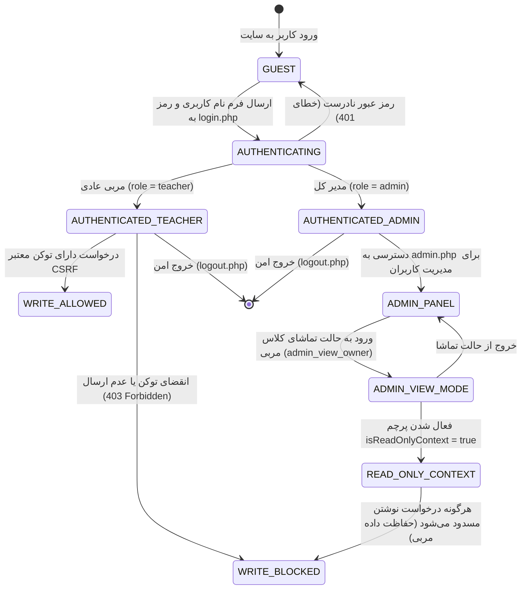

# DOMAIN MASTER: AUTHENTICATION, SECURITY & MULTI-TENANCY (AUTH_AND_SECURITY.md)

> **سند والد دامنه (Parent Domain Master)**  
> **حوزه دامنه:** احراز هویت، کنترل نشست امن، جلوگیری از جعل درخواست (CSRF)، کنترل سطوح دسترسی (RBAC) و چندمستأجری  
> **سند والد:** [`ROOT_MASTER.md`](file:///c:/xampp/htdocs/CharShanbeJalase/docs/ai/ROOT_MASTER.md)  
> **مسیر سند:** `docs/ai/domains/AUTH_AND_SECURITY.md`  
> **وضعیت:** ACTIVE & VERIFIED  

---

## ۱. مأموریت و محدوده دامنه (Domain Scope)

این دامنه امنیت کل سامانه را بدون وابستگی به فریم‌ورک‌های سنگین تأمین می‌کند:
1. مدیریت نشست امن با شناسه اختصاصی `CHSHSESSID` و چرخش دوره‌ای برای جلوگیری از Session Fixation.
2. اعتبارسنجی توکن ضدجعل (CSRF Token) در تمامی اکشن‌های تغییردهنده وضعیت (Write Actions).
3. تفکیک نقش‌های کاربری (`admin` و `teacher`) و پشتیبانی از قابلیت بازرسی امن مدیر (`admin_view_owner`).
4. ایزوله‌سازی داده‌های هر مربی بر اساس `owner_id` (معماری Multi-Tenant).

---

## ۲. دیاگرام وضعیت چرخه حیات نشست و دسترسی (Session & Access State Machine)

---

## ۳. ارجاعات کد میکروسکوپی (Deterministic Code References)

| قابلیت امنیتی | فایل مرجع | محدوده خطوط | نام تابع / نماد | شرح عملکرد |
|---|---|---|---|---|
| **پیکربندی نشست** | `auth.php` | [`#L15-L44`](file:///c:/xampp/htdocs/CharShanbeJalase/auth.php#L15-L44) | `authBootSession()` | تنظیم کوکی‌های HttpOnly, Strict Mode و چرخش شناسه هر ۳۰ دقیقه |
| **تولید توکن CSRF** | `auth.php` | [`#L49-L55`](file:///c:/xampp/htdocs/CharShanbeJalase/auth.php#L49-L55) | `csrfToken()` | تولید ۳۲ بایت رشته تصادفی امن و ذخیره در سشن |
| **اعتبارسنجی CSRF** | `auth.php` | [`#L57-L65`](file:///c:/xampp/htdocs/CharShanbeJalase/auth.php#L57-L65) | `csrfCheck(?string $token)` | مقایسه امن با `hash_equals` جهت ممانعت از حملات زمان‌بندی |
| **بررسی احراز هویت** | `auth.php` | [`#L70-L85`](file:///c:/xampp/htdocs/CharShanbeJalase/auth.php#L70-L85) | `currentUser()`, `requireLogin()` | واکشی هویت کاربر جاری یا هدایت اجباری به `login.php` |
| **تفکیک اسکوپ مالک** | `auth.php` | [`#L115-L145`](file:///c:/xampp/htdocs/CharShanbeJalase/auth.php#L115-L145) | `effectiveOwnerId()`, `isReadOnlyContext()` | استخراج مالک داده‌های فعال و تعیین وضعیت فقط‌خواندنی |
| **گارد اعتبارسنجی API** | `api.php` | [`#L12-L22`](file:///c:/xampp/htdocs/CharShanbeJalase/api.php#L12-L22) | `requireAdminApi()`, `requireCsrfApi()` | رد درخواست‌های فاقد صلاحیت پیش از رسیدن به کنترلرها |
| **لیست اکشن‌های حساس**| `api.php` | [`#L22`](file:///c:/xampp/htdocs/CharShanbeJalase/api.php#L22) | `CHARSHANBE_WRITE_ACTIONS` | آرایه اکشن‌های تغییردهنده دیتابیس مشمول الزام توکن CSRF |

---

## ۴. منشور نبایدهای امنیتی (Security Invariants)

> ⛔ **خطوط قرمز دامنه امنیت و احراز هویت:**

1. **نباید هیچ اکشن تغییردهنده‌ای بدون توکن CSRF اجرا شود:** در صورت نامعتبر بودن توکن ارسالی در هدر `X-CSRF-TOKEN` یا بدنه درخواست، سرور باید فوراً با خطای ۴۰۳ پاسخ دهد (`api.php#L44-L47`).
2. **نباید مدیر در حالت تماشا (Inspect Mode) قادر به ویرایش اطلاعات مربی باشد:** به هیچ وجه نباید در زمان فعال بودن `isReadOnlyContext()` اجازه ثبت یا تغییر داده صادر شود (`api.php#L39-L41`).
3. **نباید کوکی‌های نشست بدون فلگ `httponly` تولید شوند:** برای جلوگیری از حملات XSS، کوکی سشن همیشه غیرقابل دسترسی از طریق جاوااسکریپت مرورگر است (`auth.php#L23`).
4. **نباید پسوردهای متنی یا با هش‌های ضعیف در دیتابیس ثبت شوند:** استفاده از `password_hash(..., PASSWORD_DEFAULT)` با الگوریتم قوی استاندارد الزامی است.
