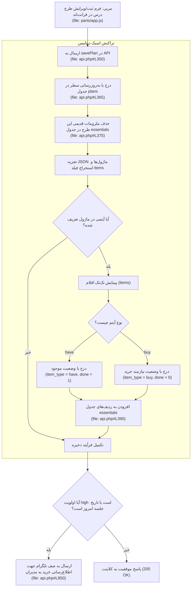

# DOMAIN MASTER: CURRICULUM, ACTIVITIES & CLASSROOM TOOLS (CURRICULUM_AND_ACTIVITIES.md)

> **سند والد دامنه (Parent Domain Master)**  
> **حوزه دامنه:** طرح درس‌های جامع، سین زمان‌بندی جلسه، ماژول‌های اجرایی، ملزومات کلاسی، آرشیو فعالیت‌ها و ابزارهای مربی  
> **سند والد:** [`ROOT_MASTER.md`](file:///c:/xampp/htdocs/CharShanbeJalase/docs/ai/ROOT_MASTER.md)  
> **مسیر سند:** `docs/ai/domains/CURRICULUM_AND_ACTIVITIES.md`  
> **وضعیت:** ACTIVE & VERIFIED  

---

## ۱. مأموریت و ساختار طرح درس (Curriculum Architecture)

این دامنه قلب طراحی آموزشی سامانه است:
1. **طرح درس جامع (Comprehensive Plan):**
   - **شناسه (`id`):** شناسه یکتای زمان‌پایه (`timestamp`).
   - **تاریخ و عنوان:** تاریخ برگزاری و نام سرفصل جلسه.
   - **سین برنامه (`sin`):** زمان‌بندی خط‌به‌خط اجرای جلسه (مثلاً: ۱۸:۰۰ شروع، ۱۸:۲۰ بازی اول و...).
   - **اولویت خرید (`priority`):** سطوح `low` (پایین)، `mid` (متوسط) و `high` (بالا) جهت یادآوری خرید اقلام.
   - **ماژول‌ها (`modules` در قالب JSON):** بخش‌های تفکیک‌شده جلسه شامل:
     - 🎲 **بازی (Game):** مسابقات و بازی‌های گروهی.
     - 📖 **داستان (Story):** مفاهیم تربیتی و داستان‌گویی.
     - 🕌 **یاد حضرت (Yade Hazrat):** محتوای مذهبی و معنوی.
     - 🚌 **اردو (Trip):** برنامه‌های خارج از کلاس.
     - 📝 **سایر (Other):** فعالیت‌های کارگاهی و آزاد.
2. **ملزومات جلسه (`essentials`):** استخراج خودکار وسایل مورد نیاز از دل هر ماژول به دو دسته:
   - `have` (موجود در پایگاه/کلاس ✅).
   - `buy` (نیازمند خرید از بازار 🛒).
3. **پیوست‌های چندرسانه‌ای (`plan_files`):** امکان آپلود PDF، عکس، صوت یا اسلاید برای هر طرح درس در `uploads/plans/`.
4. **جعبه ابزار کلاسی:** تایمر/کرنومتر محلی، ثبت گروه‌بندی دستی و فعالیت‌های آزاد.

---

## ۲. دیاگرام ساختار و استخراج خودکار ملزومات از طرح درس (Module & Essentials Flow)

---

## ۳. ارجاعات کد میکروسکوپی (Deterministic Code References)

| عملیات / مؤلفه | فایل مرجع | محدوده خطوط | نام نماد | توضیحات فنی |
|---|---|---|---|---|
| **جداول پایگاه داده** | `bootstrap.php` | [`#L63-L64`](file:///c:/xampp/htdocs/CharShanbeJalase/bootstrap.php#L63-L64) | جدول‌های `plans`, `essentials` | ساختار ذخیره متادیتا، سین، ماژول‌ها و اقلام خرید |
| **جدول فایل‌های پیوست** | `bootstrap.php` | [`#L68`](file:///c:/xampp/htdocs/CharShanbeJalase/bootstrap.php#L68) | جدول `plan_files` | نگهداری مسیر فایل‌های محلی پیوست‌شده به طرح‌ها |
| **واکشی طرح درس‌ها** | `api.php` | [`#L320-L345`](file:///c:/xampp/htdocs/CharShanbeJalase/api.php#L320-L345) | تابع `getPlans($pdo, $limit, $offset)` | مرتب‌سازی نزولی بر اساس تاریخ و بارگذاری ملزومات |
| **ذخیره اتمیک طرح درس**| `api.php` | [`#L350-L405`](file:///c:/xampp/htdocs/CharShanbeJalase/api.php#L350-L405) | تابع `savePlan($pdo, $id, ...)` | ثبت طرح و همگام‌سازی کامل اقلام ملزومات مرتبط |
| **حذف طرح درس** | `api.php` | [`#L410-L435`](file:///c:/xampp/htdocs/CharShanbeJalase/api.php#L410-L435) | تابع `deletePlan($pdo, $id)` | حذف طرح و اقلام خرید و فایل‌های فیزیکی آپلودشده |
| **آپلود پیوست طرح** | `api.php` | [`#L980-L1015`](file:///c:/xampp/htdocs/CharShanbeJalase/api.php#L980-L1015) | تابع `uploadPlanFile($pdo)` | ذخیره در `uploads/plans/{plan_id}/` با کنترل حجم و نوع |
| **آرشیو و یادداشت‌ها** | `api.php` | [`#L460-L510`](file:///c:/xampp/htdocs/CharShanbeJalase/api.php#L460-L510) | توابع `saveManualLog()`, `saveNote()` | ثبت وقایع آزاد، گروه‌بندی‌ها و صورتجلسات |

---

## ۴. منشور نبایدهای دامنه طرح درس (Domain Invariants)

> ⛔ **خطوط قرمز دامنه طرح درس:**

1. **نباید حذف طرح درس باعث باقی ماندن ملزومات یتیم در دیتابیس شود:** همگام با حذف یک رکورد از `plans`، تمامی ردیف‌های مربوطه در `essentials` و `plan_files` باید در همان تراکنش پاک شوند (`api.php#L415-L425`).
2. **نباید شناسه یکتای ملزومات (`uid`) دچار تصادم شود:** هر وسیله در جدول `essentials` باید دارای `uid` یکتا باشد تا دکمه‌های تایید ربات تلگرام (`DONE_{uid}`) مستقیماً همان آیتم را هدف قرار دهند (`bootstrap.php#L64`).
3. **نباید فایل‌های با پسوند خطرناک ذخیره شوند:** آپلود فایل‌های اجرایی (`.php`, `.exe`, `.sh`) در بخش پیوست‌های طرح درس به شدت ممنوع است و نوع فایل و MIME باید توسط سرور اعتبارسنجی شود.
4. **نباید ساختار JSON ماژول‌ها بدون اعتبارسنجی ذخیره شود:** در صورت نامعتبر بودن ساختار ورودی ماژول‌ها، بک‌اند باید خطا بازگرداند تا از آسیب به رندرر فرانت‌اند جلوگیری شود.
