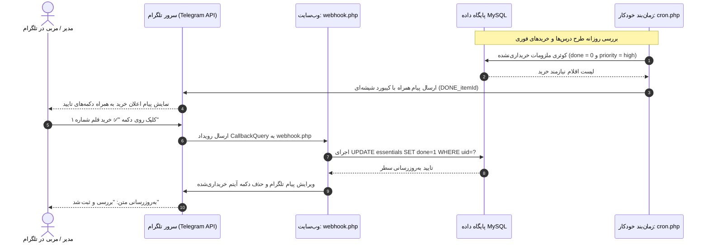

# DOMAIN MASTER: INFRASTRUCTURE, AUTOMATION & TELEGRAM (INFRASTRUCTURE_AUTOMATION.md)

> **سند والد دامنه (Parent Domain Master)**  
> **حوزه دامنه:** ربات تلگرام، وبهوک، صف ارسال آفلاین، وظایف زمان‌بندی‌شده (Cron)، پشتیبان‌گیری دیتابیس و PWA  
> **سند والد:** [`ROOT_MASTER.md`](file:///c:/xampp/htdocs/CharShanbeJalase/docs/ai/ROOT_MASTER.md)  
> **مسیر سند:** `docs/ai/domains/INFRASTRUCTURE_AUTOMATION.md`  
> **وضعیت:** ACTIVE & VERIFIED  

---

## ۱. مأموریت و قابلیت‌های زیرساخت و اتوماسیون (Domain Scope)

این دامنه پیوند سامانه با دنیای پیرامون و پایداری عملیاتی را عهده‌دار است:
1. **ربات تلگرام و یادآوری خرید (Telegram Automation):**
   - ارسال فهرست خریدهای فوری جلسه (`priority = high` یا جلسات روز جاری) به چت مدیران با کیبورد شیشه‌ای.
   - مربی/مدیر با زدن دکمه `✅ خرید شد (DONE_{uid})` در تلگرام، بلافاصله وضعیت آن وسیله را در دیتابیس به خریداری‌شده (`done = 1`) تغییر می‌دهد.
   - پاسخ خودکار به دستورات `/start` و `/id` جهت استخراج شناسه عددی چت برای درج در تنظیمات.
2. **صف ارسال پیام‌ها (`telegram_queue`):** در صورت قطع لحظه‌ای اینترنت یا فیلترینگ، پیام‌ها در صف ذخیره شده و پس از برقراری ارتباط با دستور `flushTelegramQueue` یا کران ارسال می‌شوند.
3. **پشتیبان‌گیری بومی (Database Backups):**
   - خروجی کامل ساختار و داده در فرمت SQL خالص از طریق `backup.php?type=sql`.
   - خروجی متادیتا و لاگ‌ها در قالب JSON از طریق `backup.php?type=json`.
4. **قابلیت آفلاین با PWA (`sw.js`):** کش کردن شل برنامه و استایل‌ها به طوری که در قطع موقت شبکه داخلی، مرورگر خطای عدم ارتباط ندهد.

---

## ۲. توالی ارتباط دوطرفه وب‌سایت و تلگرام (Telegram Webhook & Alert Sequence)

---

## ۳. ارجاعات کد میکروسکوپی (Deterministic Code References)

| مؤلفه / وظیفه | فایل مرجع | محدوده خطوط | نام نماد | توضیحات فنی |
|---|---|---|---|---|
| **جدول صف تلگرام** | `bootstrap.php` | [`#L69`](file:///c:/xampp/htdocs/CharShanbeJalase/bootstrap.php#L69) | جدول `telegram_queue` | نگهداری پیام‌های معلق با تعداد تلاش (`attempts`) و متن خطا |
| **ارسال امن به تلگرام**| `bootstrap.php` | [`#L520-L565`](file:///c:/xampp/htdocs/CharShanbeJalase/bootstrap.php#L520-L565) | تابع `telegramApi($token, $method, ...)` | ارتباط cURL با پشتیبانی از پراکسی محلی و زمان انقضای درخواست |
| **دریافت‌کننده وبهوک** | `webhook.php` | [`#L1-L31`](file:///c:/xampp/htdocs/CharShanbeJalase/webhook.php#L1-L31) | فایل `webhook.php` | پردازش `callback_query` دکمه‌های تلگرام و پاسخ به دستور `/id` |
| **کران‌جاب روزانه** | `cron.php` | [`#L1-L70`](file:///c:/xampp/htdocs/CharShanbeJalase/cron.php#L1-L70) | اسکریپت `cron.php` | استخراج اقلام خرید، ضدتکرار با هشدارها و ارسال روزانه به مدیران |
| **موتور پشتیبان‌گیری** | `backup.php` | [`#L1-L90`](file:///c:/xampp/htdocs/CharShanbeJalase/backup.php#L1-L90) | اسکریپت `backup.php` | دامپ مستقیم جداول دیتابیس به صورت SQL DDL+DML و JSON |
| **سرویس ورکر آفلاین** | `sw.js` | [`#L1-L60`](file:///c:/xampp/htdocs/CharShanbeJalase/sw.js#L1-L60) | فایل `sw.js` | استراتژی Cache First برای فایل‌های استاتیک و Network First برای API |
| **تخلیه صف پیام‌ها** | `api.php` | [`#L890-L930`](file:///c:/xampp/htdocs/CharShanbeJalase/api.php#L890-L930) | تابع `flushTelegramQueue($pdo)` | بازتلاش ارسال پیام‌های مانده در صف پس از اتصال مجدد شبکه |

---

## ۴. منشور نبایدهای زیرساخت (Infrastructure Invariants)

> ⛔ **خطوط قرمز دامنه زیرساخت و تلگرام:**

1. **نباید قطعی اینترنت مانع از عملکرد پنل کاربری شود:** تمامی قابلیت‌های سایت باید حتی در حالت قطع کامل اینترنت جهانی به طور بی‌نقص کار کنند و شکست در ارتباط با سرورهای تلگرام هرگز نباید متوقف‌کننده پاسخ API به کاربر باشد (`api.php#L860-L870`).
2. **نباید هشدار تکراری به تلگرام ارسال شود:** هر هشدار خرید باید پیش از ارسال در جدول تاریخچه هشدارهای تلگرام بررسی شود تا از اسپم شدن مربیان جلوگیری شود (`bootstrap.php#L70`).
3. **نباید توکن ربات تلگرام در لاگ‌های عمومی یا سورس‌کد افشا شود:** توکن ربات باید به طور محرمانه در دیتابیس ذخیره شده و در لاگ خطاها سانسور گردد.
4. **نباید خروجی بکاپ بدون احراز هویت دانلود شود:** دسترسی به `backup.php` باید کاملاً مشروط به ورود مدیر یا کلید اختصاصی امنیتی باشد تا داده‌های سامانه در دسترس عموم قرار نگیرد.
