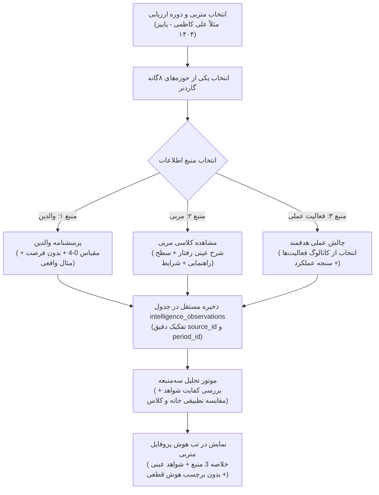

# DOMAIN MASTER: MULTIPLE INTELLIGENCES & TALENT DISCOVERY (INTELLIGENCE_MI_SYSTEM.md)

> **سند والد دامنه (Parent Domain Master)**  
> **حوزه دامنه:** هوش‌های چندگانه هوارد گاردنر (۸ حوزه)، ثبت مشاهدات رفتاری، شاخص‌های استعدادیابی و نمودارهای تحلیلی  
> **سند والد:** [`ROOT_MASTER.md`](file:///c:/xampp/htdocs/CharShanbeJalase/docs/ai/ROOT_MASTER.md)  
> **مسیر سند:** `docs/ai/domains/INTELLIGENCE_MI_SYSTEM.md`  
> **وضعیت:** ACTIVE & VERIFIED  

---

## ۱. مأموریت و مبانی علمی دامنه هوش (Domain Mission & Principles)

سامانه بر پایه نظریه علمی **هوش‌های چندگانه هوارد گاردنر (Howard Gardner)** توسعه یافته و ۸ هوش بنیادین را پایش می‌کند:
1. 🗣️ **زبانی - کلامی (Linguistic):** بیان شیوا، درک مطلب، دایره واژگان.
2. 🔢 **منطقی - ریاضی (Logical-Mathematical):** حل مسئله، استدلال، تفکر محاسباتی.
3. 🎨 **تصویری - فضایی (Visual-Spatial):** تجسم ذهنی، نقشه‌خوانی، هنر و طراحی.
4. ⚽ **بدنی - جنبشی (Bodily-Kinesthetic):** مهارت‌های حرکتی، تعادل، ورزش، زبان بدن.
5. 🎵 **موسیقایی - ریتمیک (Musical):** درک ضرب‌آهنگ، تمپو، حساسیت به صداها.
6. 🤝 **میان‌فردی (Interpersonal):** همدلی، رهبری گروه، تعامل موثر، روابط اجتماعی.
7. 🧘 **درون‌فردی (Intrapersonal):** خودآگاهی، مدیریت خشم و احساسات، استقلال رای.
8. 🌿 **طبیعت‌گرا (Naturalistic):** انس با طبیعت و محیط‌زیست، شناخت جانداران و پدیده‌ها.

### ساختار لاگ‌گذاری مشاهدات سه‌منبعه (Triangulated Assessment):
- هر ارزیابی در چارچوب یک **دوره ارزیابی (Period)** و تفکیک‌شده به ۳ منبع مستقل ثبت می‌شود:
  1. **گزارش والدین:** بافت خانه، مقیاس ۰ تا ۴، به همراه گزینه حیاتی «فرصت مشاهده نداشته‌ام» (فاقد امتیاز).
  2. **مشاهدات مربی:** بافت کلاس و تعاملات جمعی، شرح عینی رفتار، درجه استقلال و شرایط وقوع.
  3. **فعالیت‌های عملی:** چالش‌های طراحی‌شده متناسب با سن با سنجه‌های شفاف ارزیابی (Rubrics).
- **منع ترکیب عددی:** هیچ میانگین‌گیری وزنی ساختگی انجام نمی‌شود؛ خروجی مقایسه‌ای و کیفی است طبق [`MASTER_07_MULTIPLE_INTELLIGENCES_MULTI_SOURCE_ASSESSMENT.md`](file:///c:/xampp/htdocs/CharShanbeJalase/docs/ai/masters/MASTER_07_MULTIPLE_INTELLIGENCES_MULTI_SOURCE_ASSESSMENT.md).

---

## ۲. دیاگرام جریان ارزیابی سه‌منبعه هوش (Multi-Source Assessment Flow)

---

## ۳. ارجاعات کد میکروسکوپی (Deterministic Code References)

| قابلیت / مؤلفه | فایل مرجع | محدوده خطوط | نام نماد | توضیحات فنی |
|---|---|---|---|---|
| **تعریف ساختار دیتابیس**| `bootstrap.php` | [`#L65-L66`](file:///c:/xampp/htdocs/CharShanbeJalase/bootstrap.php#L65-L66) | جدول‌های `mi_config`, `mi_logs` | ساختار جدول‌های اولیه هوش و رفتارها |
| **مایگریشن پیشرفته نسخه ۸**| `bootstrap.php`| [`#L120-L245`](file:///c:/xampp/htdocs/CharShanbeJalase/bootstrap.php#L120-L245)| تابع `migrateMISystem($pdo)` | ایجاد جداول تخصصی دامنه‌ها، زمینه‌ها، منابع و امتیازات |
| **واکشی دامنه‌های هوش** | `api.php` | [`#L550-L580`](file:///c:/xampp/htdocs/CharShanbeJalase/api.php#L550-L580) | تابع `getIntelligenceDomains($pdo)` | دریافت لیست ۸ هوش همراه با رفتارهای مثبت و منفی |
| **ثبت هوشمند مشاهده** | `api.php` | [`#L605-L660`](file:///c:/xampp/htdocs/CharShanbeJalase/api.php#L605-L660) | تابع `submitMIObservation($pdo, ...)`| ذخیره هم‌زمان در جدول جدید و لگسی برای سازگاری کامل |
| **پروفایل هوش متربی** | `api.php` | [`#L670-L720`](file:///c:/xampp/htdocs/CharShanbeJalase/api.php#L670-L720) | تابع `getStudentMIProfileNew($pdo, $name)`| تولید خروجی داده برای نمودار میله‌ای و ریز لاگ‌ها |
| **ماژول رابط کاربری فرانت**| `parts/mi-new.js`| [`#L1-L220`](file:///c:/xampp/htdocs/CharShanbeJalase/parts/mi-new.js#L1-L220) | کامپوننت UI ثبت و بازبینی هوش | رابط واکنش‌گرا و سریع برای انتخاب رفتار با تاچ آسان |
| **رسم میله‌ای نمودار** | `parts/chart.js`| [`#L180-L270`](file:///c:/xampp/htdocs/CharShanbeJalase/parts/chart.js#L180-L270)| موتور محلی رسم Bar Chart | نمایش میله‌های رنگی افقی درصد انطباق هوش در صفحه متربی |

---

## ۴. منشور نبایدهای دامنه هوش و استعدادیابی (Domain Invariants)

> ⛔ **خطوط قرمز دامنه هوش:**

1. **نباید هیچ داده تاریخی در مهاجرت‌ها مفقود شود:** ارتقا به نسخه جدید MI باید صددرصد لاگ‌های گذشته را در جدول `mi_logs_legacy` حفظ کند (`MI_MIGRATION_REPORT.md`).
2. **نباید نمودار هوش به کتابخانه‌های آنلاین متکی باشد:** رسم نمودارهای هوش باید کاملاً با جاوااسکریپت و بدون وابستگی به CDN خارجی انجام شود (`parts/chart.js`).
3. **نباید عناوین هوش‌ها به طور دلخواه دستکاری شوند:** دسته‌بندی هشت‌گانه گاردنر استاندارد علمی سیستم است و هرگونه تغییر در اسامی پایه باید با هماهنگی سند والد انجام شود.
4. **نباید امتیازهای هوش با امتیازات انضباطی کلاسی ترکیب شوند:** امتیازات هوش صرفاً سنجه استعدادیابی کیفی هستند و با امتیازات حضور و غیاب در جدول `students.score` جمع ریاضی نمی‌شوند.
