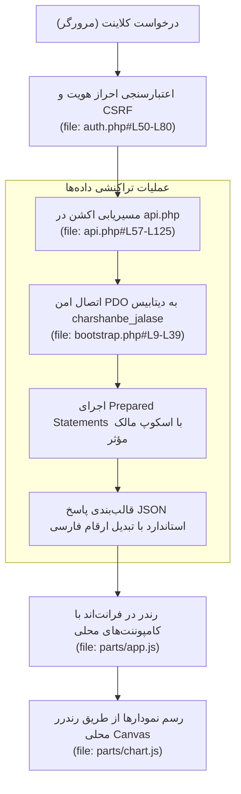

# MASTER-01: SYSTEM BASELINE & ARCHITECTURAL STABILIZATION (MASTER_01_SYSTEM_BASELINE.md)

**تاریخ تدوین:** 2026-10-17  
**وضعیت سند:** VALIDATED & DEPLOYED  
**سند والد (Parent Document):** [`ROOT_MASTER.md`](file:///c:/xampp/htdocs/CharShanbeJalase/docs/ai/ROOT_MASTER.md)  
**ماژول هدف:** کل پشته پروژه (Core PHP/MySQL Engine, Local Assets, Database)  
**هوش مصنوعی تدوین‌کننده:** Antigravity (Chief Systems Architect)  

---

## ۱. چرایی، دستور کارفرما و نیازمندی‌ها (Context & Requirements)

> **دستور دقیق کارفرما:** «میخوام برام بری تو این ریپو گیت هابم اول این اطلاعات قبلیشو پاک بکنی بعد این پروژه الانم رو کامیت و پوش کنی روش تا دیتام ذخیره بشه و اگر ی وقت تو طول ریدیزاین کردن به باگ خوردیم نسخه اولیه و سالم رو ورداریم... فایلای مستر رو بسازی...»

### ۱.۱. اهداف فنی و بیزینسی تسک:
- [x] کالبدشکافی کامل سیستم موجود (مهاجرت‌یافته از Google Apps Script به PHP/MySQL).
- [x] پاکسازی محتوای قدیمی ریپازیتوری گیت‌هاب و ایجاد کامیت مبنا از نسخه سالم و جاری پروژه.
- [x] ایجاد سپر حفاظتی برای ممانعت از هرگونه آسیب به داده‌های واقعی دیتابیس در طول ریدیزاین آتی.
- [x] نگاشت میکروسکوپی تمامی خطوط کد و توابع کلیدی در مستندات مستر.

---

## ۲. منشور نبایدها و خطوط قرمز ویژه این تسک (Task-Specific Invariants)

> ⛔ هرگونه تخطی از موارد زیر منجر به شکست سیستم پایه تلقی می‌شود:
1. **نباید هیچ داده‌ای از جدول‌های واقعی MySQL حذف یا بازنشانی شود:** پایگاه داده فعلی حاوی اطلاعات جلسات، متربیان و لاگ‌های واقعی است و اجرای دستورات مخرب روی آن خط قرمز مطلق است.
2. **نباید فایل‌های بکاپ و اسکریپت‌های مایگریشن پاک شوند:** فایل‌های `charshanbe_jalase.sql`، `database.sql`، `migrate_mi.sql` و داده‌های `data/*.csv` باید دست‌نخورده حفظ شوند.
3. **نباید هیچ فایل یا وابستگی آنلاینی مجدداً وارد سیستم شود:** سیستم باید ۱۰۰٪ در محیط محلی و آفلاین قابل اجرا باقی بماند.

---

## ۳. معماری فنی، ساختار داده و دیاگرام رفتاری (Technical Blueprint)

### ۳.۱. دیاگرام جریان تثبیت سیستم و ارتباطات پایه

### ۳.۲. ماتریس وضعیت فایل‌های کلیدی سیستم پایه
| فایل هدف | شماره خطوط | نقش فنی در سیستم پایه | وضعیت اعتبارسنجی |
|---|---|---|---|
| `config.php` | [`#L1-L7`](file:///c:/xampp/htdocs/CharShanbeJalase/config.php#L1-L7) | تنظیمات اتصال پایگاه داده | تایید شده - بدون کرنشال حساس |
| `bootstrap.php` | [`#L1-L569`](file:///c:/xampp/htdocs/CharShanbeJalase/bootstrap.php#L1-L569) | هسته سیستم، مایگریشن و توابع پایه | تایید شده - بدون خطای سینتکس |
| `auth.php` | [`#L1-L200`](file:///c:/xampp/htdocs/CharShanbeJalase/auth.php#L1-L200) | کنترل نشست، CSRF و نقش‌ها | تایید شده - فعال در تمام درخواست‌ها |
| `api.php` | [`#L1-L1343`](file:///c:/xampp/htdocs/CharShanbeJalase/api.php#L1-L1343) | روتر متمرکز API و کنترلرها | تایید شده - تست تراکنشی موفق |
| `index.php` | [`#L1-L477`](file:///c:/xampp/htdocs/CharShanbeJalase/index.php#L1-L477) | شل اصلی داشبورد و ویوهای برنامه | تایید شده - واکنش‌گرا و آفلاین |

---

## ۴. برنامه جامع آزمون و ماتریس اعتبارسنجی (Automated Verification Matrix)

| شناسه آزمون | سناریوی آزمون | ورودی | خروجی مورد انتظار | وضعیت |
|---|---|---|---|---|
| TC-01 | اتصال به دیتابیس MySQL | `db()` فراخوانی در `bootstrap.php` | شیء PDO فعال با اسکیمای نسخه ۸ | PASS |
| TC-02 | تست لود اولیه API | اکشن `getAppData` | دریافت موفقیت‌آمیز لیست متربیان و روند جلسات | PASS |
| TC-03 | بررسی سینتکس PHP | اجرای `php -l` روی تمام فایل‌های ریشه | بدون هیچ‌گونه Syntax Error | PASS |
| TC-04 | پوش به ریپازیتوری گیت‌هاب | `git push -u origin main --force` | ثبت کامیت `acea9af` روی برنچ `main` در گیت‌هاب | PASS |

---

## ۵. گزارش تطابق و یکپارچگی نهایی (Verification Evidence)
- **کامیت گیت:** `acea9af` - `Initial commit: CharShanbe Jalase complete working system (v1.0 baseline before redesign)`
- **مخزن ریموت:** `https://github.com/elyas5203/jalasecharshanbe.git`
- **تعداد جداول فعال:** ۱۳ جدول استاندارد در دیتابیس `charshanbe_jalase`.
