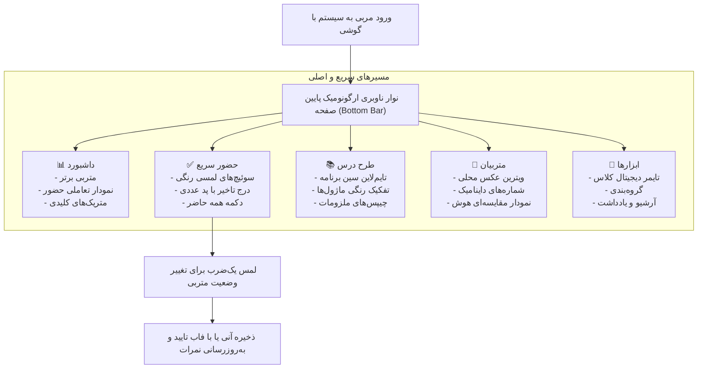

# MASTER-02: COMPREHENSIVE UI/UX MODERN REDESIGN (MASTER_02_UI_UX_REDESIGN.md)

**تاریخ تدوین:** 2026-10-17  
**وضعیت سند:** IN_PROGRESS (آماده دریافت بازخورد و اعمال فازبندی)  
**سند والد (Parent Document):** [`ROOT_MASTER.md`](file:///c:/xampp/htdocs/CharShanbeJalase/docs/ai/ROOT_MASTER.md)  
**ماژول هدف:** لایه ارائه (Presentation Layer: `assets/app.css`, `index.php`, `parts/app.js`, `parts/chart.js`)  
**هوش مصنوعی تدوین‌کننده:** Antigravity (Chief Systems Architect)  

---

## ۱. چرایی، دستور کارفرما و نیازمندی‌ها (Context & Requirements)

> **دستور دقیق کارفرما:** «میخوام ری دیزاین بکنم سیستم رو کلا از لحاظ ui ux... کلا ui/ux وارد یک مرحله و بعد دیگه بکن برام... دقت بکن ۹۰ درصد کاربرهای من قراره با گوشی وارد بشن پس خیلی دقت داشته باش ک درست باشه ظاهرش تو گوشی...»

### ۱.۱. اهداف فنی و بصری تسک:
1. **طراحی موبایل‌فرست (Mobile-First Ergonomics):** بهینه‌سازی نقاط لمس (Touch Targets حداقل ۴۴ پیکسل)، فواصل انگشت‌رس در نوار پایین و ناوبری تک‌دستی روان.
2. **ارتقای زبان بصری به استانداردهای ۲۰۲۶:**
   - استفاده از متغیرهای مدرن CSS (Tokens)، افکت‌های عمق نرم (Layered Shadows) و کاردینگی تمیز.
   - حذف کامل احساس شلختگی، متن‌های توضیحی تکراری و عناصر بصری زائد.
3. **بهبود مؤلفه‌های اختصاصی:**
   - **نمودار هوش‌های چندگانه:** ستون‌های میله‌ای افقی مقایسه‌ای کنار هم برای تحلیل در یک نگاه روی صفحه موبایل.
   - **نمودار روند حضور و غیاب:** نمودار تعاملی با خط راهنمای عمودی و کارت پاپ‌آپ درصد حضور، حاضرین، غایبین، تاخیرها و موجهین.
   - **ثبت حضور و غیاب ارگونومیک:** جایگزینی Dropdownهای قدیمی با سوئیچ‌ها/قرص‌های رنگی لمسی سریع (Present/Absent/Late/Excused).
   - **شماره تماس‌های داینامیک:** کارت‌های مرتب با لیبل‌های مشخص (پدر، مادر، برادر، خود متربی و...) و امکان افزودن نامحدود.
   - **اسپینر تاریخ:** انتخاب‌گر تاریخ چرخشی شمسی فوق‌العاده نرم و زیبا.

---

## ۲. منشور نبایدها و خطوط قرمز ویژه بازطراحی (Task-Specific Invariants)

> ⛔ هرگونه تخطی از موارد زیر منجر به رد خودکار کار خواهد شد:
1. **نباید منطق بیزینس و محاسبات بک‌اند دستکاری یا شکسته شود:** تمامی اکشن‌های `api.php` و محاسبات توابع `recalculateStudentAttendanceAndScore` و توکن‌های CSRF باید ۱۰۰٪ بدون تغییر و سازگار باقی بمانند.
2. **نباید هیچ کتابخانه یا فایل خارجی/CDN به پروژه اضافه شود:** بازطراحی باید صرفاً بر پایه فونت لوکال، CSS داخلی و وانیلا جاوااسکریپت اجرا شود.
3. **نباید المنت‌ها در صفحه‌نمایش‌های کوچک موبایل دچار اسکرول افقی ناخواسته (Horizontal Overflow) شوند.**
4. **نباید داده‌های موجود در دیتابیس یا فایل‌های آپلودشده (`uploads/`) آسیب ببینند.**

---

## ۳. معماری فنی و دیاگرام جریان تجربه کاربری جدید (UX Flow Blueprint)

---

## ۴. ماتریس تغییر فایل‌ها و نمادها (File Mutation Matrix)

| فایل هدف | شماره خطوط تقریبی | نوع تغییر | مؤلفه‌های هدف | اقدام کنترلی و تست |
|---|---|---|---|---|
| `assets/app.css` | [`#L1-L800`](file:///c:/xampp/htdocs/CharShanbeJalase/assets/app.css) | بازطراحی کامل استایل‌ها | متغیرهای طراحی، تم تیره/روشن، کارت‌ها، کلیدها، نوار پایین | تست در ابعاد مختلف ۳۶۰px تا ۴۳۰px موبایل |
| `index.php` | [`#L1-L477`](file:///c:/xampp/htdocs/CharShanbeJalase/index.php) | نوسازی ساختار HTML | چیدمان سکشن‌ها، بهینه‌سازی فرم‌ها، حذف المنتهای قدیمی | عدم شکست تگ‌های PHP و متغیرهای نشست |
| `parts/app.js` | [`#L1-L500`](file:///c:/xampp/htdocs/CharShanbeJalase/parts/app.js) | بهینه‌سازی تعاملات | رندر مدرن کارت‌ها، تعامل سوئیچ‌های حضور، انیمیشن‌های نرم | بررسی سلامت فراخوانی‌های `api.php` |
| `parts/chart.js`| [`#L1-L280`](file:///c:/xampp/htdocs/CharShanbeJalase/parts/chart.js) | ارتقای بصری رندرر | افکت‌های گرادیانت، خط راهنمای نرم، برچسب‌های واضح در موبایل | تست عدم وجود نشت حافظه روی Canvas |

---

## ۵. برنامه جامع آزمون و ماتریس اعتبارسنجی (Automated Verification Matrix)

| شناسه آزمون | سناریوی آزمون | داده ورودی | خروجی مورد انتظار | وضعیت |
|---|---|---|---|---|
| TC-01 | تست ریسپانسیو موبایل | عرض ۳۷۵ پیکسل (iPhone SE / عموم گوشی‌ها) | عدم وجود overflow-x، دکمه‌های کاملاً در دسترس | آماده اجرا در فاز ۱ |
| TC-02 | ثبت حضور و غیاب سریع | لمس سوئیچ «تاخیر» با مقدار ۱۵ | ارسال به `submitAttendance` و محاسبه نمره | آماده اجرا در فاز ۱ |
| TC-03 | ذخیره شماره تماس داینامیک | افزودن شماره «برادر» در پروفایل | ذخیره در دیتابیس در قالب JSON و بازیابی صحیح | آماده اجرا در فاز ۱ |
| TC-04 | رندر نمودار هوش در موبایل | واکشی ۸ هوش متربی | نمایش ۸ میله افقی متناسب بدون برش یا همپوشانی | آماده اجرا در فاز ۱ |
