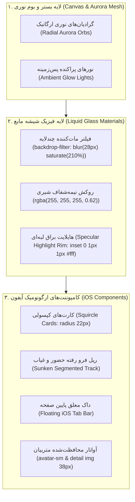

# MASTER-03: پیاده‌سازی زبان طراحی شیشه‌ای مایع اصیل آیفون (iOS Authentic Liquid Glass) و ارگونومی تطبیقی

> **سند فرزند اجرایی (Child Execution Master)**  
> **پروتکل مرجع:** پروتکل جامع معماری مستر و حافظه شناختی مشترک (UMAC-P)  
> **مسیر سند:** `docs/ai/masters/MASTER_03_IOS_LIQUID_GLASS.md`  
> **سند والد ریشه:** [`docs/ai/ROOT_MASTER.md`](file:///c:/xampp/htdocs/CharShanbeJalase/docs/ai/ROOT_MASTER.md)  
> **تصمیم معمارانه مرتبط:** [`DEC-0006`](file:///c:/xampp/htdocs/CharShanbeJalase/docs/ai/DECISIONS.md)

---

## ۱. تحلیل نیازمندی و بیانیه هدف (Problem Statement & Objective)

کارفرما پس از مشاهده نسخه آزمایشی بازخورد داد که تم قبلی حس شیشه مایع واقعی آیفون (iOS) را منتقل نمی‌کند و همچنین عکس متربی در بخش سوابق حضور و غیاب (`attendance-detail-row img`) به صورت نامتعارف و بسیار بزرگ کشیده شده است.

### ارکان فیزیک شیشه‌ای iOS (Apple iOS 18 Design Physics):
۱. **نورپردازی ارگانیک پس‌زمینه (Aurora Mesh Canvas):** در آیفون، شیشه مات بدون والپیپر رنگی غنی در زیر آن معنا ندارد. وقتی رنگ زمینه تخت یا خاکستری کم‌رنگ باشد، فیلتر `backdrop-filter` هیچ بازتاب یا انکساری نشان نمی‌دهد. پس‌زمینه باید شامل لایه‌های گرد نوری ملایم و زنده (Vibrant Aurora Orbs) باشد.  
۲. **بازتاب لبه‌های سه‌بعدی و خط نور براق (Specular Highlight Rims):** شیشه مایع اپل دارای هایلایت ظریف نور روی لبه بالایی (`inset 0 1px 1px 0 rgba(255, 255, 255, 0.9)`) و سایه ملایم پراکنده در لبه پایینی است.  
۳. **کنترل‌های سه‌حالته فرورفته (Sunken Segmented Controls):** کنترل‌های حضور و غیاب باید شبیه به کنترل‌های ناوبری iOS در یک ریل فرورفته مات با کپسول متحرک سفید برجسته سوار شوند.  
۴. **داک شناور معلق با ارگونومی استاندارد (Floating iOS Dock):** نوار پایین صفحه به صورت کپسول معلق شیشه‌ای با فیلتر بلور قوی و حاشیه نوری بازطراحی می‌شود.  
۵. **مهار قطعی ابعاد تمامی تصاویر (Image Safety Invariant):** رفع باگ عکس بزرگ در سوابق حضور و الزام قاعده `max-width: 100%` و سایزبندی دقیق تمامی آواتارها (۳۸ پیکسل گرد با حاشیه شیشه‌ای).

---

## ۲. دیاگرام ساختار لایه‌های شیشه‌ای مایع (Mermaid Architecture)

---

## ۳. منشور نبایدها و خطوط قرمز اختصاصی تسک (Invariants & Prohibitions)

۱. **نباید** هیچ شناسه کاربری (`id`)، نام تابع جاوااسکریپت، رویداد کلیک (`onclick`) یا مسیر فراخوانی API حذف یا دستکاری شود.  
۲. **نباید** تصاویر بدون تعریف صریح `width`, `height`, `object-fit: cover` رندر شوند؛ به‌ویژه در بخش سوابق حضور [`parts/app.js#L892`](file:///c:/xampp/htdocs/CharShanbeJalase/parts/app.js#L892) و استایل‌های [`assets/app.css`](file:///c:/xampp/htdocs/CharShanbeJalase/assets/app.css).  
۳. **نباید** هیچ CDN یا کتابخانه خارجی اضافه شود (قانون Zero-CDN).  
۴. **نباید** فونت وزیرمتن و تنظیمات فاصله‌گذاری کلمات مختل شود.  
۵. **نباید** تغییرات ساختار دیتابیس داده شود؛ داده‌های واقعی بدون کم‌وکاست نمایش داده می‌شوند.

---

## ۴. برنامه گام‌به‌گام پیاده‌سازی (Step-by-Step Implementation Plan)

- **گام ۱:** افزودن قوانین مهار قطعی تصویر در سراسر سیستم و به طور خاص `.attendance-detail-row img` و `.attendance-session-body`.
- **گام ۲:** غنی‌سازی بستر رنگی پس‌زمینه با گوی‌های نوری ارگانیک (Aurora Mesh Orbs) در حالت روز و شب جهت تولید انکسار واقعی شیشه مایع.
- **گام ۳:** ارتقای توکن‌های بازتاب شیشه (`--glass-shadow`, `--glass-border`, `--glass-highlight`) با فرمول رفلکس آیفون.
- **گام ۴:** بازطراحی کنترل‌های حضور و غیاب مطابق با Segmented Controls استاندارد iOS (کپسول سفید برجسته روی ریل فرورفته شیشه‌ای).
- **گام ۵:** بازطراحی داک شناور پایین صفحه با کپسول معلق و فیلتر اپل.
- **گام ۶:** اعتبارسنجی با لود صفحه، بررسی بدون خطا در کنسول، تست PHP lint و ثبت کامیت در گیت‌هاب.
