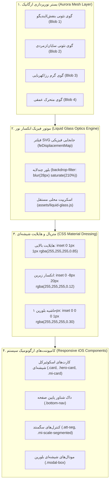

# MASTER-03: پیاده‌سازی زبان طراحی شیشه‌ای مایع اصیل آیفون (iOS Authentic Liquid Glass) و ارگونومی تطبیقی

> **سند فرزند اجرایی (Child Execution Master)**  
> **پروتکل مرجع:** پروتکل جامع معماری مستر و حافظه شناختی مشترک (UMAC-P)  
> **مسیر سند:** `docs/ai/masters/MASTER_03_IOS_LIQUID_GLASS.md`  
> **سند والد ریشه:** [`docs/ai/ROOT_MASTER.md`](file:///c:/xampp/htdocs/CharShanbeJalase/docs/ai/ROOT_MASTER.md)  
> **تصمیم معمارانه مرتبط:** [`DEC-0006`](file:///c:/xampp/htdocs/CharShanbeJalase/docs/ai/DECISIONS.md)  
> **اسکیل مرجع متصل:** [`docs/ai/skills/SKILL_LIQUID_GLASS.md`](file:///c:/xampp/htdocs/CharShanbeJalase/docs/ai/skills/SKILL_LIQUID_GLASS.md) | [`docs/ai/skills/LIQUID_GLASS_README.md`](file:///c:/xampp/htdocs/CharShanbeJalase/docs/ai/skills/LIQUID_GLASS_README.md)

---

## ۱. بیانیه هدف و تحلیل نیازمندی (Problem Statement & Objective)

کارفرما اعلام کرد که ظاهر سامانه نیاز به تحول اساسی داشته و باید به استاندارد **شیشه مایع اصیل آیفون (Authentic Apple iOS Liquid Glass)** مجهز گردد. علاوه بر زیبایی بصری، سامانه باید کاملاً ریسپانسیو بوده، در گوشی‌های هوشمند بدون هیچ شکستگی کار کند و کاربری روان و ارگونومیک ارائه دهد.

### ارکان شش‌گانه فیزیک و متریال Liquid Glass (Apple iOS 18/26 Standard):
۱. **نورپردازی زنده آئورا (Dynamic Aurora Mesh Canvas):**  
   شیشه مات و انکسار نور روی پس‌زمینه خاکستری یا یکنواخت به پلاستیک مات کدر تبدیل می‌شود. برای بازتاب واقعی، پس‌زمینه مجهز به گوی‌های ارگانیک نوری چندرنگ متحرک (`.ios-ambient-mesh .ios-blob`) با بلور ۹۰ پیکسلی و گرادیان‌های نئونی ملایم (بنفش ایندیگو، سایان، زمردی و کهربایی) است.
   
۲. **انکسار نوری و اعوجاج فیزیکی لبه‌ها (SVG Displacement Optics):**  
   با بهره‌گیری از ماژول مرجع محلی `assets/liquid-glass.js` (بدون CDN و صفر وابستگی خارجی)، انکسار نوری و تغییر ضریب شکست نور روی حاشیه کامپوننت‌ها پیاده‌سازی می‌شود. مرورگرهای مبتنی بر کرومیوم به کمک فیلتر SVG و نقشه جابجایی پیکسل‌ها (`feDisplacementMap` + `feTurbulence`) محتوای زیر لبه شیشه را به شکل واقعی می‌پیچانند، و در سایر مرورگرها فالبک فوق‌سریع Frosted Blur اعمال می‌گردد.

۳. **هایلایت‌های براق لبه‌ای و سوزاندگی نور (Specular Rim Highlights & Caustics):**  
   شیشه مایع با فرمول سه‌لایه رندر می‌شود:
   - لایه خط نور بالایی: `inset 0 1px 1px rgba(255, 255, 255, 0.85)`
   - بازتاب انکساری پایینی: `inset 0 -8px 20px rgba(255, 255, 255, 0.12)`
   - خط کریستالی ۱ پیکسلی دور تا دور: `inset 0 0 0 1px rgba(255, 255, 255, 0.28)`
   - سایه دیفیوز معلق: `0 20px 50px rgba(0, 0, 0, 0.10)` در حالت روز و `0 24px 60px rgba(0, 0, 0, 0.55)` در حالت شب.

۴. **کنترل‌های کپسولی فرورفته و برآمده (Sunken & Floating Squircle Controls):**  
   کنترل‌های حضور و غیاب، تب‌های استعدادیابی و ناوبری به صورت ریل فرورفته (`background: rgba(120, 120, 128, 0.14); backdrop-filter: blur(20px)`) با کپسول‌های فعال متحرک سفید برجسته یا شیشه‌ای روشن پیاده‌سازی می‌شوند.

۵. **داک ناوبری شناور معلق با رعایت حریم دسترسی (Floating iOS Glass Dock):**  
   داک ناوبری در کپسول معلق با خمیدگی ۳۶ پیکسل، بلور ۳۰ پیکسلی و فاصله ایمن از پایین صفحه شناور است؛ ارتفاع بدنه و پدینگ پایین صفحه طوری تنظیم می‌شود که آخرین محتوای صفحات هرگز زیر داک پنهان نماند.

۶. **ریسپانسیویتی تمام‌عیار موبایل (Mobile-First Ergonomics):**  
   رفع کراش ستون‌ها در صفحات کوچک؛ شبکه‌های ۴ ستونه و ۳ ستونه در صفحات زیر ۴۸۰ پیکسل به طور خودکار به آرایش ۲ ستونه یا اسکرول لمسی تغییر می‌کنند، تایپوگرافی هدر فشرده و ایمن می‌شود و مودال‌ها روی تمام سایزها فیت می‌گردند.

---

## ۲. دیاگرام ساختار لایه‌های شیشه‌ای مایع (Mermaid Architecture)

---

## ۳. منشور خطوط قرمز و نبایدها (Invariants & Prohibitions)

۱. **نباید** هیچ کتابخانه خارجی یا CDN اضافه شود؛ اسکریپت `liquid-glass.js` و فونت وزیرمتن کاملاً محلی و آفلاین هستند.  
۲. **نباید** هیچ شناسه عنصری (`id`)، رویداد کلیک (`onclick`)، نام متغیر یا توابع هسته دستکاری شوند.  
۳. **نباید** خوانایی فونت فارسی (کنتراست متن روی شیشه) مخدوش شود؛ ضریب ماتی در پشت متن‌ها به گونه‌ای تنظیم شده که متون کاملاً واضح و با کنتراست بالای WCAG AAA خوانده شوند.  
۴. **نباید** عکس‌ها در هیچ شرایطی بدون مهار `max-width: 100%` و ابعاد معین رندر شوند (قاعده ایمنی تصویر).  
۵. **نباید** المان‌های بزرگتر از کادر مجاز پردازش سنگین شوند؛ ماژول انکسار سبک و متناسب با کارت‌ها، داک و هدر کالیبره می‌شود.

---

## ۴. برنامه گام‌به‌گام پیاده‌سازی (Step-by-Step Execution Plan)

- [x] **گام ۱:** دانلود و بررسی اسکیل مرجع Liquid Glass و ذخیره در `docs/ai/skills/SKILL_LIQUID_GLASS.md` و استقرار کتابخانه محلی در `assets/liquid-glass.js`.
- [ ] **گام ۲:** فعال‌سازی کامل استایل‌های انیمیشنی گوی‌های نور ارگانیک آئورا در `assets/app.css` برای عناصر `.ios-ambient-mesh` و `.ios-blob` در حالت روز و شب.
- [ ] **گام ۳:** اعمال متریال شیشه مایع اپل (هایلایت‌های براق `inset 0 1px 1px`، انکسار `inset 0 -8px 20px`، حاشیه کریستالی و گرادیان نیمه‌شفاف) روی تمام کلاس‌های `.card`، `.bottom-nav`، `.modal-box`، `.sidebar`، `.hero-card`، `.action-tile` و `.mi-card`.
- [ ] **گام ۴:** به‌روزرسانی پالت رنگی و کلاس‌های کارت‌های آمار (`sp-summary-stats` و کارنامه عملکرد) به متریال شیشه‌ای مات و شفاف هماهنگ.
- [ ] **گام ۵:** افزودن ماتریس ریسپانسیو اختصاصی برای دستگاه‌های موبایل (پوشش صفحات ۳۲۰px، ۳۷۵px، ۴۱۴px، ۷۶۸px و بالاتر) در `assets/app.css`.
- [ ] **گام ۶:** بارگذاری ماژول `assets/liquid-glass.js` در `index.php` و فعال‌سازی هوشمند انکسار شیشه‌ای روی داک، هدر و کارت‌ها با مدیریت ریسایز و فالبک.
- [ ] **گام ۷:** اعتبارسنجی جامع با PHP lint، بررسی بدون خطا در اسکریپت‌ها و گزارش به کاربر.
