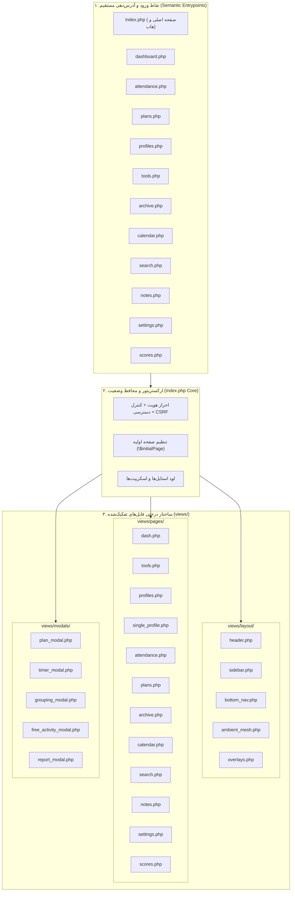

# MASTER-04: تفکیک ماژولار صفحات و معماری ویوهای مجزا (Modular Page-by-Page Architecture)

> **سند فرزند اجرایی (Child Execution Master)**  
> **پروتکل مرجع:** پروتکل جامع معماری مستر و حافظه شناختی مشترک (UMAC-P)  
> **مسیر سند:** `docs/ai/masters/MASTER_04_MODULAR_PAGES_ARCHITECTURE.md`  
> **سند والد ریشه:** [`docs/ai/ROOT_MASTER.md`](file:///c:/xampp/htdocs/CharShanbeJalase/docs/ai/ROOT_MASTER.md)  
> **تصمیم معمارانه مرتبط:** [`DEC-0007`](file:///c:/xampp/htdocs/CharShanbeJalase/docs/ai/DECISIONS.md)

---

## ۱. بیانیه مسئله و تحلیل چرایی شکست در گذشته (Post-Mortem)

کارفرما دستور داد:
> «این الان همه چیز تو ی فایل ایندکسه نمیخوام اینطوری باشه میخوام صفحه به صفحه بشه جدا بشه. ولی این کارو ی بار قدیم کردم خراب شد سیستمم... بعد اینک ادرس دهی ها همه بهم میریزه توابع و... میخوام خط به خط بخونی و درستش بکنی برام. این عکسه هم فرستادم ببین خرابه درستش بکن برام... /goal»

### چرا تفکیک صفحات در تلاش‌های گذشته سیستم را متلاشی کرد؟
۱. **وابستگی شدید جاوااسکریپت به تمامی عناصر DOM:**
   در سامانه فعلی، فایل [`parts/app.js`](file:///c:/xampp/htdocs/CharShanbeJalase/parts/app.js) در هنگام لود (`initApp()`) توابعی را صدا می‌زند که نیازمند وجود عناصر تمام تب‌ها در DOM هستند (مانند `profiles-list`، `plans-list`، `att-date`، `archive-list`، `mainChartBox` و ...). در تلاش قبلی، با جدا کردن فیزیکی فایل‌های HTML، زمانی که مثلاً صفحه حضور و غیاب باز می‌شد، المان‌های داشبورد در صفحه نبودند و خطای مهلک `TypeError: Cannot read properties of null` کل اجرای جاوااسکریپت را متوقف می‌کرد.
۲. **از بین رفتن حافظه مشترک و وضعیت پویا (State Loss):**
   لود مجدد و کامل صفحه در هر جابجایی موجب خالی شدن شیء `window.DB`، لود دوباره سنگین API، از کار افتادن تایمرهای فعال کلاسی و پرش صفحه می‌شد.
۳. **بهم‌ریختگی آدرس‌دهی و متغیرهای امنیتی:**
   متغیرهای اساسی احراز هویت و امنیت مانند `$__csrf`، `$__readOnly`، `$__miEnabled` در فایل‌های بریده‌شده از دست می‌رفتند.
۴. **باگ چیدمان مودال گروه‌بندی (تصویر ارسالی کاربر):**
   عدم تعریف ابعاد تصویر متربیان (`.student-select-card img`) و چیدمان افقی به جای عمودی باعث انبساط غیرعادی کارت‌ها، خرد شدن متن اسامی و اسکرول دوبل افقی و عمودی شده بود.

---

## ۲. راهکار معمارانه: الگوی تفکیک ماژولار ایمن (Safe-Separation Pattern)

برای دستیابی به تفکیک ۱۰۰٪ صفحه به صفحه، تمیزی کد و دسترسی مستقیم با آدرس اختصاصی بدون شکستن حتی یک تابع، معماری سه‌لایه‌ای زیر پیاده‌سازی می‌شود:

---

## ۳. منشور نبایدها و خطوط قرمز تفکیک (Invariants & Prohibitions)

۱. **نباید** هیچ شناسه کاربری (`id`) در هیچ تگی تغییر یابد؛ تمامی شناسه‌ها باید عیناً حفظ شوند تا سازگاری توابع در `parts/app.js` صد درصد بماند.  
۲. **نباید** هیچ رویداد `onclick`، `oninput`، `onkeyup` یا فراخوانی تابعی دستکاری یا حذف شود.  
۳. **نباید** عملکرد نرم و بدون رفرش تب‌ها مختل شود؛ جابجایی تب‌ها در درون برنامه باید با انیمیشن‌های شیشه‌ای انجام شده و همزمان آدرس مرورگر به روزرسانی شود (`history.pushState`).  
۴. **نباید** عکس‌های متربیان بدون صفت‌های محافظ در مودال گروه‌بندی قرار گیرند؛ باید ابعاد دقیق ۵۰×۵۰ با گردی ۵۰٪ داشته باشند.  
۵. **نباید** فایل‌های اصلی بدون تست سینتکس (`php -l`) به گیت پوش شوند.

---

## ۴. برنامه اجرایی گام‌به‌گام (Implementation Plan)

- **گام ۱ (رفع باگ بصری تصویر):** تثبیت استایل‌های کامل `.student-select-card` و `.student-select-grid` در `assets/app.css` جهت مهار قطعی عکس‌های بزرگ و اسکرول‌های اضافه.
- **گام ۲ (ایجاد دایرکتوری‌ها):** ایجاد پوشه‌های `views/layout/`، `views/pages/` و `views/modals/`.
- **گام ۳ (استخراج لایه‌های مشترک):** انتقال هدر، سایدبار، داک پایین، مش پس‌زمینه و اورلی‌ها به `views/layout/`.
- **گام ۴ (استخراج تک‌تک ویوها):** تفکیک ۱۲ ویوی اصلی به فایل‌های مجزا در `views/pages/`.
- **گام ۵ (استخراج مودال‌ها):** تفکیک ۵ مودال سامانه به فایل‌های مجزا در `views/modals/`.
- **گام ۶ (بازسازی پاکیزه `index.php`):** ترکیب ساختار یافته و شفاف ویوها با قابلیت تعیین `$initialPage` بر اساس پارامتر `?page=...`.
- **گام ۷ (ایجاد نقاط ورود مستقل):** ساخت فایل‌های تک‌صفحه‌ای کم‌حجم (`attendance.php`, `plans.php`, `profiles.php`, ...) جهت دسترسی مستقیم.
- **گام ۸ (هماهنگ‌سازی روتر فرانت‌اند):** بروزرسانی تابع `nav()` در `parts/app.js` جهت ثبت تاریخچه مرورگر بدون رفرش (`history.pushState`).
- **گام ۹ (اعتبارسنجی جامع):** تست سینتکس PHP تمام فایل‌ها، تست مرورگر، تست لاگین، تست دیتابیس و ثبت کامیت در گیت.
