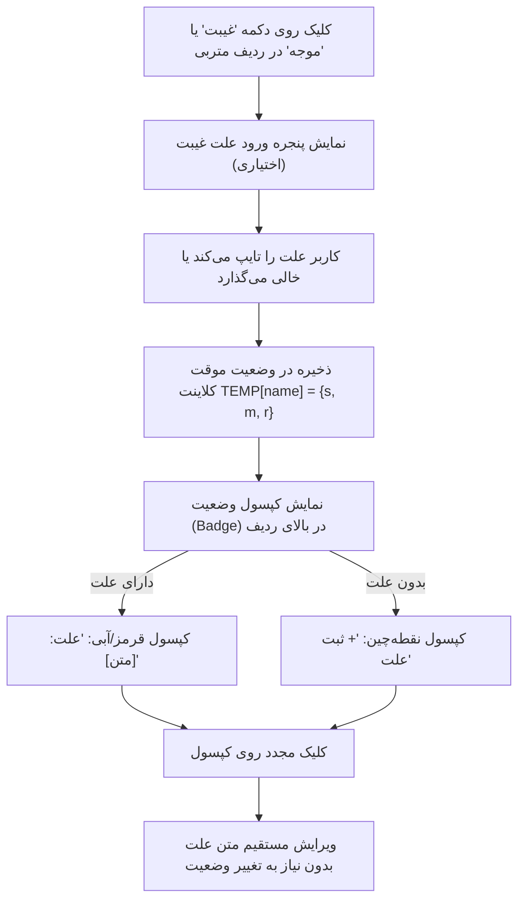

# MASTER 06: ثبت و ردگیری علت غیبت متربیان (MASTER_06_ABSENCE_REASON_RECORDING.md)

> **سند فرزند اجرایی (Execution Child Master)**  
> **حوزه دامنه:** پرونده متربیان، جلسات حضور و غیاب، ثبت علت غیبت و غیبت‌های موجه  
> **سند والد دامنه:** [`STUDENTS_AND_ATTENDANCE.md`](file:///c:/xampp/htdocs/CharShanbeJalase/docs/ai/domains/STUDENTS_AND_ATTENDANCE.md)  
> **مسیر سند:** `docs/ai/masters/MASTER_06_ABSENCE_REASON_RECORDING.md`  
> **وضعیت:** ACTIVE & PRODUCTION READY  
> **تصمیم معماری مرتبط:** [`DEC-0009`](file:///c:/xampp/htdocs/CharShanbeJalase/docs/ai/DECISIONS.md)  

---

## ۱. هدف و چرایی بیزینس (Objective & Pedagogical Rationale)

در فرآیند تربیتی و آموزشی، صرف دانستن این که یک متربی «غایب» بوده است کافی نیست؛ آگاهی از چرایی غیبت (بیماری، سفر، تداخل با آزمون‌های مدرسه، مشکلات خانوادگی یا عدم اطلاع) تفاوت میان یک غیبت بحرانی با یک عذر موجه است.  
پیش از این، در جدول `attendance_records` ستونی برای ثبت علت غیبت وجود نداشت و مربی امکان یادداشت دلیل عدم حضور متربی در جلسه را نداشت.

این سند معماری استقرار ویژگی ثبت علت غیبت را با رعایت اصول زیر تعیین می‌نماید:
1. **ثبت اختیاری و بدون اصطکاک (Frictionless UX):** مربی می‌تواند به سرعت وضعیت غیبت را ثبت کند و ثبت علت اختیاری است؛ هیچ اجباری که سرعت عمل ثبت حضور را کُند کند وجود ندارد.
2. **پشتیبانی از غیبت عادی و موجه (Absent & Excused):** قابلیت ثبت علت هم برای غیبت عادی (`Absent`) و هم برای غیبت موجه (`Excused`) فراهم است.
3. **ذخیره‌سازی ساختاریافته (Structured Storage):** علت در ستون اختصاصی `absence_reason` در پایگاه داده ذخیره می‌شود و همزمان در متون توضیحی (`status_text`)، اعلان‌های تلگرام و تاریخچه پروفایل متربی منعکس می‌گردد.
4. **ویرایش‌پذیری سریع (In-place Editability):** کپسول علت در ردیف حضور و غیاب تعبیه شده و با یک کلیک قابل بازبینی یا ویرایش است.

---

## ۲. مشخصات فنی پایگاه‌داده (Database Schema & Migration)

### ۲.۱. ساختار فیلد در جدول `attendance_records`

```sql
ALTER TABLE `attendance_records` 
ADD COLUMN `absence_reason` VARCHAR(255) NULL AFTER `late_minutes`;
```

- **نوع داده:** `VARCHAR(255)` با پشتیبانی کامل از کاراکترهای فارسی (`utf8mb4_unicode_ci`).
- **مقدار پیش‌فرض:** `NULL` (برای حضورها یا غیبت‌های بدون توضیح).
- **شاخص نسخه:** ارتقای `SCHEMA_VERSION` از `8` به `9` در [`bootstrap.php`](file:///c:/xampp/htdocs/CharShanbeJalase/bootstrap.php).
- **مایگریشن خودکار:** استفاده از متد بازگشت‌پذیر `ensureColumn($pdo, 'attendance_records', 'absence_reason', 'VARCHAR(255) NULL')` در هسته `bootstrap.php`.

---

## ۳. قراردادهای ارتباطی API (API Contracts)

### ۳.۱. ارسال حضور و غیاب (`submitAttendance`)

فرمت ورودی شیء رکورد در درخواست POST به متد `submitAttendance`:

```json
{
  "date": "1405/01/20",
  "records": [
    {
      "name": "علی رضایی",
      "status": "Absent",
      "min": 0,
      "reason": "سرماخوردگی شدید"
    },
    {
      "name": "محمد امین‌فر",
      "status": "Excused",
      "min": 0,
      "reason": "هماهنگ با ولی جهت شرکت در مسابقه"
    },
    {
      "name": "امیر علی صمدی",
      "status": "Late",
      "min": 15,
      "reason": ""
    }
  ]
}
```

### ۳.۲. خروجی جزئیات جلسه (`getAttendanceSessionDetails`)

فیلد `reason` در کنار `status`، `lateMinutes` و `text` بازگردانده می‌شود:

```json
{
  "name": "علی رضایی",
  "image": "uploads/students/ali.jpg",
  "status": "Absent",
  "lateMinutes": 0,
  "reason": "سرماخوردگی شدید",
  "text": "غیبت (سرماخوردگی شدید)"
}
```

### ۳.۳. نمایش در تاریخچه پروفایل متربی (`getStudentDetails` & `getComprehensiveStudentHistory`)

علت ثبت‌شده در آیتم‌های تاریخچه و تایم‌لاین فعالیت‌ها به صورت شفاف نمایش می‌یابد:
- تاریخچه حضور: `{ "date": "1405/01/20", "status": "غیبت (سرماخوردگی شدید)", "reason": "سرماخوردگی شدید", "statusCode": "Absent" }`
- تایم‌لاین رویدادها: `"desc": "غیبت (علت: سرماخوردگی شدید)"`

### ۳.۴. اعلان هوشمند تلگرام (`pushAlertsToTelegram` & `TG_NOTIFY_ATTENDANCE`)

پیام ارسالی به گروه مدیران در تلگرام شامل علت غیبت غایبین و موجهین خواهد بود:
```text
📋 حضور و غیاب ثبت شد
📅 تاریخ: 1405/01/20

✅ حاضر: 12 نفر
❌ غایب: علی رضایی (علت: سرماخوردگی شدید)
🕐 تاخیر: 0
ℹ️ موجه: محمد امین‌فر (علت: مسابقه ورزشی)
```

---

## ۴. رابط کاربری و تجربه تعاملی (UI / UX Flow)



---

## ۵. منشور عدم رگرسیون و خطوط قرمز (Invariants)

1. **انصراف از ثبت علت نباید وضعیت غیبت را لغو کند:** اگر مربی روی دکمه غیبت کلیک کرد و در پاپ‌آپ علت دکمه انصراف را زد یا چیزی تایپ نکرد، متربی همچنان «غایب» باقی می‌ماند و حضور به‌موقع تلقی نمی‌شود.
2. **محاسبات ریاضی نمرات دست‌نخورده باقی بماند:** اضافه شدن علت غیبت هیچ‌گونه تغییری در موتور محاسبه نمره سیستمی و مدل تاخیر پلکانی (DEC-0008) ایجاد نمی‌کند.
3. **سازگاری با رکوردهای گذشته:** رکوردهای قبلی که مقدار `absence_reason` آن‌ها `NULL` است، بدون کوچک‌ترین اختلال یا خطای ظاهری به عنوان غیبت عادی نمایش داده می‌شوند.
