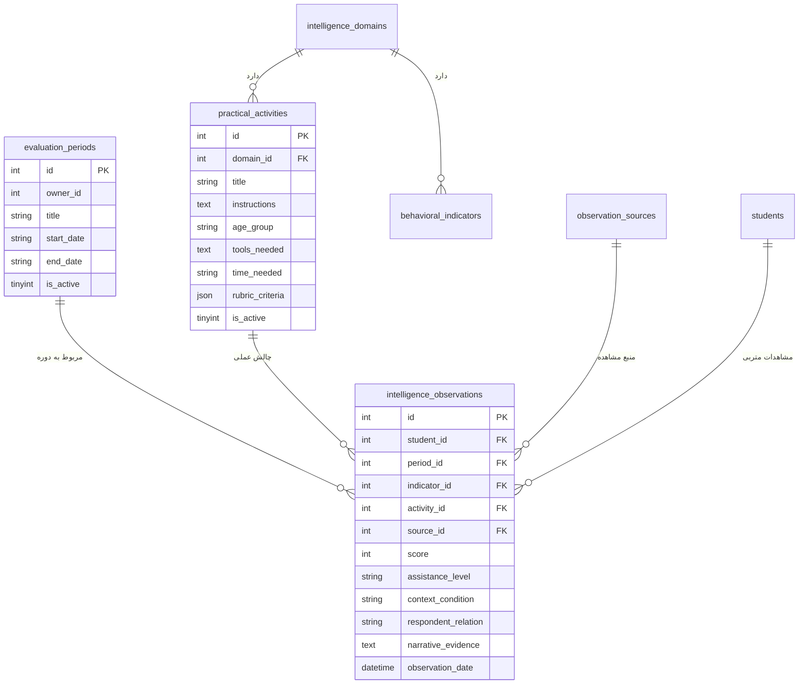

# MASTER 07: سامانه ارزیابی سه‌منبعه هوش‌های چندگانه گاردنر و متد پروژه اسپکتروم هاروارد (MASTER_07_MULTIPLE_INTELLIGENCES_MULTI_SOURCE_ASSESSMENT.md)

> **سند فرزند اجرایی (Execution Child Master)**  
> **حوزه دامنه:** پرونده متربیان، هوش‌های چندگانه گاردنر (۸ حوزه)، پایش سه‌منبعه کیفی (والدین، مربی، چالش‌های عملی اسپکتروم)، دوره‌های ارزیابی و داشبورد تحلیلی مقایسه‌ای  
> **سند والد دامنه:** [`INTELLIGENCE_MI_SYSTEM.md`](file:///c:/xampp/htdocs/CharShanbeJalase/docs/ai/domains/INTELLIGENCE_MI_SYSTEM.md)  
> **مسیر سند:** `docs/ai/masters/MASTER_07_MULTIPLE_INTELLIGENCES_MULTI_SOURCE_ASSESSMENT.md`  
> **وضعیت:** ACTIVE IMPLEMENTATION (Phase 13)  
> **تصمیم معمارانه مرتبط:** [`DEC-0010`](file:///c:/xampp/htdocs/CharShanbeJalase/docs/ai/DECISIONS.md)  

---

## ۱. بیانیه مأموریت و خطوط قرمز تربیتی (Mission & Ethical Invariants)

هدف این سیستم، **تهیه یک پروفایل توصیفی، کیفی، چندبُعدی و قابل‌به‌روزرسانی از علایق، رفتارها و توانمندی‌های مشاهده‌شده متربی در بافت‌های گوناگون** است؛ نه آزمون استاندارد هوش، نه محاسبه ضریب هوشی (IQ) و نه برچسب‌زدن قطعی بر استعدادهای کودک.

### منشور اخلاقی و نبایدهای بنیادین دامنه:
1. **ممنوعیت محاسبه نمره/درصد نهایی ترکیبی خودسرانه:** سیستم نباید اوزان دلخواه و غیرعلمی (مثلاً ۳۰٪ والدین، ۳۰٪ مربی، ۴۰٪ عملی) تعیین کند و یک عدد واحد به عنوان «هوش کودک» ارائه دهد. فراوانی رفتار، علاقه و کیفیت عملکرد سه مقوله مجزا هستند.
2. **ممنوعیت تلقی «عدم مشاهده» به عنوان «ضعف کودک»:** گزینه «فرصت مشاهده نداشته‌ام» یا فقدان داده، به معنی کمبود شواهد است (`شواهد ناکافی`)، نه نمره صفر و نه توانمندی پایین.
3. **پذیرش و حفظ تفاوت گزارش منابع (Triangulation):** اگر رفتاری در خانه مشاهده شده اما در کلاس بروز نکرده است، هیچ‌کدام غلط نیستند؛ سیستم این تمایز را به عنوان سرنخ آموزشی تبیین می‌کند.
4. **حفظ کامل ۲۹۷ رکورد داده‌های گذشته (`mi_logs_legacy`):** هیچ دیتای تاریخی پاک نمی‌شود و داده‌های گذشته با برچسب منبع «سوابق اولیه (بدون تفکیک منبع)» در دسترس باقی می‌مانند.
5. **لحن علمی و توصیفی در UI و هوش مصنوعی:** عباراتی مانند «هوش قطعی»، «کودک ضعیف»، «استعداد اثبات‌شده» یا پیش‌بینی آینده شغلی اکیداً ممنوع است.

---

## ۲. پژوهش و بنچ‌مارک بین‌المللی متدهای روز ارزیابی تربیتی

### ۲.۱. چارچوب پروژه اسپکتروم هاروارد (Harvard Project Zero - Project Spectrum)
* **پدیدآورندگان:** هاوارد گاردنر (Howard Gardner) و دیوید هنری فلدمن (David Henry Feldman) در دانشگاه هاروارد.
* **اصل بنیادین:** رد آزمون‌های مداد-کاغذی در سنجش هوش کودکان؛ ارزیابی اصیل (Authentic Assessment) در بستر فعالیت‌ها، بازی‌ها و پروژه‌های واقعی.
* **پروفایل به جای نمره کل (Profiles over Totals):** هوش یک عدد ثابت نیست، بلکه طیفی از توانمندی‌های پویاست که از طریق فرصت‌های محیطی پرورش می‌یابد.
* **سبک‌های کاری (Working Styles):** سنجش میزان استقلال کودک، نیاز به کمک مربی (Assistance Level)، میزان پایداری در برابر حل مسئله و وضعیت هیجانی حین فعالیت.

### ۲.۲. الگوهای تجربه کاربری (UX) برتر در پلتفرم‌های روز دنیا (Seesaw, Toddle, Storypark)
برای جلوگیری از خستگی مربیان و والدین (Survey Fatigue) و فرآیندهای طاقت‌فرسا، مدرن‌ترین و یوزر-فرندلی‌ترین متدولوژی به شرح زیر در طراحی اعمال می‌شود:
1. **ثبت سریع میکرو-لاگ مربی (Quick-Capture Micro-Logging):** امکان ثبت یک مشاهده در کمتر از ۲۰ ثانیه تنها با انتخاب چیپ حوزه هوش، انتخاب برچسب استقلال (مستقل / با راهنمایی / با کمک) و درج یک جمله روایت عینی.
2. **کارت‌های تعاملی و گفتگومحور والدین (Conversational Parent Cards):** تفکیک سوالات به کارت‌های روان، همراه با مثال‌های ملموس زندگی روزمره، و تعبیه دکمه آرامش‌بخش «فرصت مشاهده نداشته‌ام» تا والد نگران کم شدن نمره فرزندش نباشد.
3. **لانچر فعالیت‌های عملی اسپکتروم (Project Spectrum Activity Launcher):** کارت‌های چالش آماده برای هر ۸ حوزه با اهداف شفاف، روباریک کیفی ۳ سطحی و ثبت آسان تگ‌های شرایط روحی/روانی کودک.
4. **داشبورد مقایسه‌ای تطبیقی (Triangulated Visual Dashboard):** نمایش بصری ستون‌های سه‌گانه در کنار یکدیگر با رنگ‌بندی شفاف، برجسته‌سازی خودکار هم‌پوشانی‌ها و تفاوت‌های محیطی و درج توصیه‌های مربیگری.

---

## ۳. حوزه‌های هشت‌گانه گاردنر و فعالیت‌های عملی اسپکتروم (Project Spectrum Matrix)

| شناسه | حوزه هوش | موضوع اصلی بررسی | نماد | نمونه فعالیت عملی استاندارد پروژه اسپکتروم |
|---|---|---|:---:|---|
| `linguistic` | **کلامی ـ زبانی** | روایت‌کردن، توضیح‌دادن و واژگان | 🗣️ | **چالش جعبه قصه (Storyboard):** روایت یک داستان منسجم با استفاده از ۳ کارت تصویری تصادفی |
| `logical` | **منطقی ـ ریاضی** | استدلال، کشف الگو و حل مسئله | 🔢 | **چالش کشف و گسترش الگو (Pattern Quest):** ادامه یک توالی منطقی از مهره‌ها/اشکال هندسی |
| `spatial` | **تصویری ـ فضایی** | تجسم، شکل‌ها و روابط مکانی | 🎨 | **چالش بازسازی سازه (Spatial Builder):** ساخت یک حجم ۳ بعدی با بلوک‌ها/لگو از روی نمونه دوبعدی |
| `bodily` | **بدنی ـ جنبشی** | هماهنگی بدنی و مهارت‌های دستی | ⚽ | **مسیر موانع و تعادل (Obstacle Course):** اجرای توالی حرکتی تعادلی، پرش و مهارت ظریف دست |
| `musical` | **موسیقایی** | تشخیص ریتم، ملودی و تن صدا | 🎵 | **چالش بازتولید ریتم (Rhythm Echo):** شنیدن یک الگوی ضربی کوتاه و تکرار دقیق آن با دست یا ساز |
| `interpersonal` | **بین‌فردی** | درک دیگران، همکاری و ارتباط | 🤝 | **چالش مأموریت تیمی (Cooperative Puzzle):** ساخت یا حل یک معما در گروه دونفره با تقسیم نقش |
| `intrapersonal` | **درون‌فردی** | خودآگاهی، هیجانات و اهداف خود | 🧘 | **چالش نمودار احساسات (Emotion Detective):** توصیف احساس خود در یک رویداد و بیان دلیل و راهکار |
| `naturalistic` | **طبیعت‌گرا** | مشاهده و دسته‌بندی پدیده‌ها | 🌿 | **چالش طبقه‌بندی طبیعت (Nature Sorting):** مرتب‌سازی برگ‌ها، سنگ‌ها یا تصاویر بر اساس الگوهای طبیعی |

---

## ۴. مدل داده و پایگاه‌داده (Database Schema - Version 10)

---

## ۵. منطق تحلیل موتور چندمنبعه (Multi-Source Triangulation Engine)

1. **ارزیابی کفایت داده‌ها:**
   - اگر مجموع شواهد یک حوزه کمتر از ۲ رخداد باشد: برچسب `شواهد ناکافی جهت ارزیابی` فعال می‌شود.
2. **تحلیل مجزای هر منبع (تفکیک ریاضی و معنایی):**
   - **گزارش والدین:** محاسبه میانگین شاخص‌های دارای مشاهده معتبر (گزینه‌های `null` یا «بدون فرصت» نادیده گرفته می‌شوند).
   - **مشاهدات مربی:** بسامد رخدادها در کلاس + درصد استقلال (مستقل / با راهنمایی / با کمک).
   - **چالش عملی اسپکتروم:** سطح دستیابی روباریک (کامل، نسبی، تمرین) با لحاظ شرایط روحی/محیطی حین اجرا.
3. **تطبیق بین‌محیطی (Cross-Context Triangulation):**
   - تطابق بالا: رفتار پایدار در خانه و کلاس.
   - عدم تطابق: ارائه سرنخ تربیتی (مثلاً نیاز به تقویت احساس امنیت در جمع یا ایجاد فرصت‌های خانگی بیشتر).
4. **توصیه‌های یادگیری و مربیگری:**
   - ۲ راهکار عملی برای مربی و والدین برای هر حوزه.

---

## ۶. نقشه اجرای گام‌به‌گام فاز ۱۳

- [x] **گام ۱:** ارتقای سند جامع معمارانه `MASTER_07` به همراه بنچ‌مارک بین‌المللی هاروارد اسپکتروم و UX روز دنیا.
- [ ] **گام ۲:** مایگریشن دیتابیس در `bootstrap.php` (ارتقا به `SCHEMA_VERSION = '10'`، ایجاد `evaluation_periods`، `practical_activities` با ۸ چالش پیش‌فرض، و الحاق ستون‌های جدید به `intelligence_observations`).
- [ ] **گام ۳:** پیاده‌سازی اندپوینت‌های API در `api.php` برای دوره‌ها، چالش‌های اسپکتروم، ثبت سریع سه‌منبعه و محاسبه پروفایل مقایسه‌ای.
- [x] **گام ۴:** بازطراحی رابط کاربری تب هوش‌های چندگانه در `views/pages/single_profile.php` و ماژول جاوااسکریپت `parts/mi-new.js` (شامل داشبورد مقایسه‌ای، ثبت سریع مربی، فرم والدین، لانچر چالش اسپکتروم و تب سوابق قدیمی).
- [x] **گام ۵:** تست جامع انتهای به انتها، بررسی سلامت ۲۹۷ رکورد قدیمی، و مستندسازی در `CHANGELOG.md` و `PROJECT_STATE.md`.

---

## ۷. ساختار تعاملی والد و فرزند (Parent-Child Master-Detail Architecture)

برای رهایی از شلوغی و خستگی کاربر (Cognitive Overload / Survey Fatigue) در اثر باز بودن هم‌زمان ۶۴ گویه و صدها دکمه، ساختار هوش‌های چندگانه به صورت تفکیک‌شده والد و فرزند پیاده‌سازی شد:
1. **سطح والد (Parent View / نمای کلان سرفصل‌ها):**
   - نوار ابزار متوازن با انتخاب دوره ارزیابی، تولید پرامپت هوش مصنوعی، مصاحبه والدین و سوابق گذشته.
   - کارت شاخص‌های کلان عملکردی (تعداد کل مشاهدات، وضعیت پاسخ‌های والدین، ثبت‌های کلاسی و چالش‌های عملی).
   - شبکه ۸ کاشی ریسپانسیو سرفصل‌های هوش (کارت‌های مدرن با آیکون بزرگ، عنوان، درصد پیشرفت و دکمه ورود).
2. **سطح فرزند (Child View / کار برگ ارزیابی تک‌حوزه):**
   - نوار ناوبری والد و فرزند با دکمه بازگشت «← بازگشت به نمای سرفصل‌ها» و استپر پیمایش بین حوزه‌ها (`◄ حوزه قبلی | حوزه بعدی ►`).
   - کارت هیرو معرفی حوزه با آیکون و بج‌های وضعیت.
   - ۴ سربرگ متمرکز برای همان حوزه (پرسشنامه والدین با نوار مدرن ۶ گزینه‌ای، مشاهدات کلاسی مربی، بازی عملی اسپکتروم، و راهنما و تحلیل).

