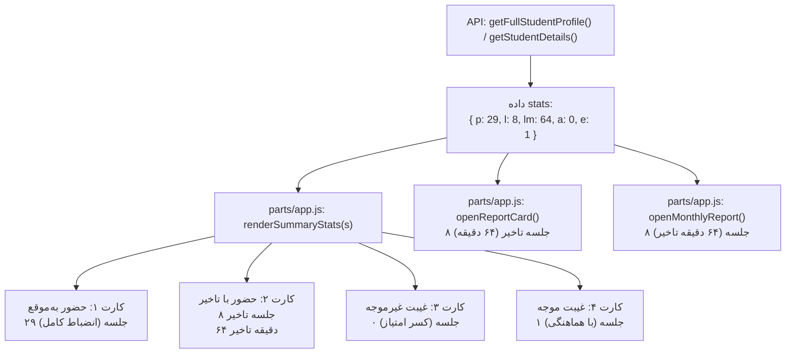

# MASTER-08: استاندارد نمایش و گزارش‌دهی آمار حضور و غیاب و تاخیرات متربیان (Attendance & Tardiness Statistics Presentation Standard)

> **سند فرزند اجرایی (Child Execution Master)**  
> **پروتکل مرجع:** پروتکل جامع معماری مستر و حافظه شناختی مشترک (UMAC-P)  
> **مسیر سند:** `docs/ai/masters/MASTER_08_ATTENDANCE_STATS_PRESENTATION.md`  
> **اسناد والد:** [`docs/ai/ROOT_MASTER.md`](file:///c:/xampp/htdocs/CharShanbeJalase/docs/ai/ROOT_MASTER.md)، [`docs/ai/masters/MASTER_05_TARDINESS_SCORING_FORMULA.md`](file:///c:/xampp/htdocs/CharShanbeJalase/docs/ai/masters/MASTER_05_TARDINESS_SCORING_FORMULA.md) و [`docs/ai/domains/STUDENTS_AND_ATTENDANCE.md`](file:///c:/xampp/htdocs/CharShanbeJalase/docs/ai/domains/STUDENTS_AND_ATTENDANCE.md)  
> **تصمیم معمارانه مرتبط:** [`DEC-0009`](file:///c:/xampp/htdocs/CharShanbeJalase/docs/ai/DECISIONS.md)  
> **وضعیت:** COMPLETED & VERIFIED ON REAL DATA  

---

## ۱. بیانیه مسئله و انگیزه کاربری (Context & Problem Statement)

در نسخه‌های قبلی پروفایل متربی، در زبانه «📊 آمار» (بخش خلاصه وضعیت حضور و غیاب)، کارت تاخیر به صورت اختصاری و مبهم نمایش داده می‌شد:
```text
حضور با تاخیر
۸ (۶۴ د)
```

### اشکالات ساختاری و تجربه کاربری (UX) وضع قبل:
1. **ابهام در واحدها:** عبارت «۶۴ د» برای مربیان و والدین مشخص نبود که آیا منظور ۶۴ دقیقه تاخیر در کل ترم است، ۶۴ درصد تاخیر است یا ۶۴ نمره کسر شده است.
2. **عدم تفکیک شفاف تعداد جلسه از دقایق:** کارفرما نیاز داشت دقیقاً مشخص باشد که دانش‌آموز **چند جلسه تاخیر** داشته و این جلسات **مجموعاً چند دقیقه تاخیر** را در بر داشته است.
3. **ناهماهنگی کارت‌ها:** در کارت‌های دیگر تنها یک عدد بدون پسوند واحد نوشته شده بود (مثلاً «۲۹» به جای «۲۹ جلسه»)، که هویت عددی را شفاف نمی‌کرد.

دستور مستقیم کارفرما:
> «اینجا میخوام برام بنویسی ک 8 جلسه تاخیر فلان مقدار دقیقه تاخیر(فایل مستر درست کن)»

---

## ۲. مشخصات استاندارد طراحی کارت‌های آماری (UI Specification)

چهار کارت آماری در زبانه آمار پروفایل متربی بر اساس استاندارد زیر بازطراحی شدند:

| وضعیت | عنوان کارت | مقدار اصلی (Main Metric) | زیرعنوان توضیحی (Sub-caption) | تم رنگی |
| :--- | :--- | :--- | :--- | :--- |
| **حضور به‌موقع** | حضور به‌موقع | **`${p} جلسه`** | انضباط کامل | سبز زمردی (`#f0fdf4` / `#166534`) |
| **حضور با تاخیر** | حضور با تاخیر | **`${l} جلسه تاخیر`** | **`${lm} دقیقه تاخیر`** | کهربایی / طلایی (`#fffbeb` / `#92400e`) |
| **غیبت غیرموجه** | غیبت غیرموجه | **`${a} جلسه`** | کسر امتیاز | رز / قرمز (`#fef2f2` / `#991b1b`) |
| **غیبت موجه** | غیبت موجه | **`${e} جلسه`** | با هماهنگی | آبی فیروزه‌ای (`#f0f9ff` / `#075985`) |

---

## ۳. معماری جریان داده و نمایش در فرانت‌اند (Data Flow & Frontend Rendering)



---

## ۴. تغییرات کد (Code Implementation)

### ۱. تابع `renderSummaryStats(s)` در [`parts/app.js`](file:///c:/xampp/htdocs/CharShanbeJalase/parts/app.js):
```javascript
function renderSummaryStats(s) {
  const h = `
    <div style="text-align:center; padding:12px 6px; background:#f0fdf4; border-radius:14px; border:1px solid #bbf7d0; display:flex; flex-direction:column; justify-content:center; min-height:86px;">
      <small style="color:#15803d; font-weight:700; font-size:0.8rem; margin-bottom:4px; display:block;">حضور به‌موقع</small>
      <b style="font-size:1.15rem; color:#166534; font-weight:800; line-height:1.3; display:block;">${toPersianNum(s.p)} جلسه</b>
      <div style="font-size:0.76rem; color:#15803d; font-weight:600; margin-top:3px;">انضباط کامل</div>
    </div>
    <div style="text-align:center; padding:12px 6px; background:#fffbeb; border-radius:14px; border:1px solid #fef3c7; display:flex; flex-direction:column; justify-content:center; min-height:86px;">
      <small style="color:#b45309; font-weight:700; font-size:0.8rem; margin-bottom:4px; display:block;">حضور با تاخیر</small>
      <b style="font-size:1.05rem; color:#92400e; font-weight:800; line-height:1.3; display:block;">${toPersianNum(s.l)} جلسه تاخیر</b>
      <div style="font-size:0.78rem; color:#b45309; font-weight:600; margin-top:3px;">${toPersianNum(s.lm)} دقیقه تاخیر</div>
    </div>
    <div style="text-align:center; padding:12px 6px; background:#fef2f2; border-radius:14px; border:1px solid #fecaca; display:flex; flex-direction:column; justify-content:center; min-height:86px;">
      <small style="color:#b91c1c; font-weight:700; font-size:0.8rem; margin-bottom:4px; display:block;">غیبت غیرموجه</small>
      <b style="font-size:1.15rem; color:#991b1b; font-weight:800; line-height:1.3; display:block;">${toPersianNum(s.a)} جلسه</b>
      <div style="font-size:0.76rem; color:#b91c1c; font-weight:600; margin-top:3px;">کسر امتیاز</div>
    </div>
    <div style="text-align:center; padding:12px 6px; background:#f0f9ff; border-radius:14px; border:1px solid #bae6fd; display:flex; flex-direction:column; justify-content:center; min-height:86px;">
      <small style="color:#0369a1; font-weight:700; font-size:0.8rem; margin-bottom:4px; display:block;">غیبت موجه</small>
      <b style="font-size:1.15rem; color:#075985; font-weight:800; line-height:1.3; display:block;">${toPersianNum(s.e)} جلسه</b>
      <div style="font-size:0.76rem; color:#0369a1; font-weight:600; margin-top:3px;">با هماهنگی</div>
    </div>
  `;
  document.getElementById('sp-summary-stats').innerHTML = h;
}
```

### ۲. ارتقای کارنامه عملکرد (`openReportCard`) و گزارش ماهانه (`openMonthlyReport`):
در کارنامه عملکرد نیز فرمت نمایش از اختصاری به فرمت استاندارد فارسی تغییر یافت:
```javascript
<span>⏰ تاخیر</span><b>${toPersianNum(stats.stats.l)} جلسه تاخیر (${toPersianNum(stats.stats.lm)} دقیقه)</b>
```

---

## ۵. تضمین‌ها و اصول پایدار (Invariants & Assurances)

1. **خوانایی صد در صد:** تمام اعداد و علائم با تابع `toPersianNum()` به زبان فارسی تبدیل می‌شوند.
2. **عدم شکستگی در صفحات موبایل (Zero Overflow):** چیدمان دوسطری در داخل کارت‌ها مانع از بیرون‌زدگی افقی متن در نمایشگرهای باریک (زیر ۳۹۰ پیکسل) می‌گردد.
3. **همگرایی با محاسبات پلکانی:** تعداد دقایق نمایش‌داده‌شده دقیقاً با فرمول امتیازدهی پلکانی در `MASTER-05` همگام است.
