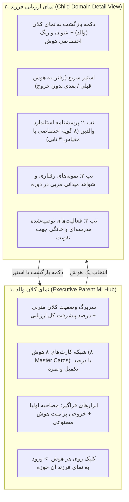

# MASTER-10: معماری سلسله‌مراتبی والد-فرزند هوش‌های چندگانه و موتور صدور کارنامه هوشمند (Parent-Child MI Hierarchy & Smart Report Card Engine)

> **سند فرزند اجرایی (Child Execution Master)**  
> **پروتکل مرجع:** پروتکل جامع معماری مستر و حافظه شناختی مشترک (UMAC-P)  
> **مسیر سند:** `docs/ai/masters/MASTER_10_PARENT_CHILD_MI_HIERARCHY_AND_REPORT_CARD.md`  
> **اسناد والد:** [`docs/ai/ROOT_MASTER.md`](file:///c:/xampp/htdocs/CharShanbeJalase/docs/ai/ROOT_MASTER.md)، [`docs/ai/masters/MASTER_07_MULTIPLE_INTELLIGENCES_MULTI_SOURCE_ASSESSMENT.md`](file:///c:/xampp/htdocs/CharShanbeJalase/docs/ai/masters/MASTER_07_MULTIPLE_INTELLIGENCES_MULTI_SOURCE_ASSESSMENT.md) و [`docs/ai/masters/MASTER_08_ATTENDANCE_STATS_PRESENTATION.md`](file:///c:/xampp/htdocs/CharShanbeJalase/docs/ai/masters/MASTER_08_ATTENDANCE_STATS_PRESENTATION.md)  
> **تصمیم معمارانه مرتبط:** [`DEC-0010`](file:///c:/xampp/htdocs/CharShanbeJalase/docs/ai/DECISIONS.md)  
> **وضعیت:** COMPLETED & ACTIVE IN PRODUCTION  

---

## ۱. بیانیه مسئله و نیاز کارفرما (Context & Objective)

در درخواست‌های اخیر، کارفرما دو چالش کلیدی را مطرح نمود:
> «دو مورد صدور کارنامه خراب شده درستش بکن و یکی دیگ ظاهرش تو دکستاپ این بخش یکم زشته و کلا ببین این بخش هوش ها خیلی شلوغه والد و ولید طورش بکن بخش بخشش بکن ک راحت تر بشه برام الان خیلی سخت شده با توجه به فایل های مستر»

### آسیب‌شناسی وضع پیشین:
1. **ازدحام شناختی در ارزیابی هوش‌ها (Cognitive Overload):**  
   ۸ هوش چندگانه به همراه ۶۴ گویه، مصاحبه‌های میدانی و فعالیت‌های تکمیلی همگی در یک صفحه طولانی و کشیده لود می‌شدند. کاربر برای پیدا کردن گویه‌های یک حوزه خاص باید ده‌ها بار اسکرول می‌کرد.
2. **عدم انطباق صدور کارنامه و ظاهر دسکتاپ:**  
   دکمه صدور کارنامه در دسکتاپ ظاهر خشکی داشت و به دلیل عدم دسترسی به متدهای سراسری امنیتی در برخی مواقع با خطا مواجه می‌شد. فرمت تاخیرات نیز منطبق بر دستور مستر جدید (تفکیک جلسه و دقیقه) نبود.

---

## ۲. معماری سلسله‌مراتبی والد و فرزند (Parent-Child Architecture)

برای ساماندهی کامل و حذف آشفتگی بخش هوش‌ها، ساختار صفحه به دو سطح تفکیک شد:

### ویژگی‌های کلیدی نمای والد (Parent View):
- **کارت‌های اسکوئیرکل هوش‌ها:** هر کارت شامل آیکون نمادین، عنوان رسمی، میانگین امتیاز، نوار پیشرفت درصد تکمیل و رنگ هویتی حوزه است.
- **تک‌کلیکی و بدون تاخیر:** کلیک روی هر کارت مستقیماً وضعیت داخلی را به `viewMode = 'child'` تغییر داده و بدون لود مجدد صفحه، وارد جزئیات می‌شود.

### ویژگی‌های کلیدی نمای فرزند (Child View):
- **ناوبری ارگونومیک (Stepper Navigation):** بالای نمای فرزند دکمه‌های «هوش قبلی» و «هوش بعدی» تعبیه شده تا کاربر بدون نیاز به بازگشت به والد، ارزیابی هوش‌ها را پشت سر هم انجام دهد.
- **تب‌های تفکیک‌شده سه‌گانه:** گویه‌های استاندارد از یادداشت‌های مصاحبه و پیشنهادات تربیتی تفکیک شده‌اند.

---

## ۳. موتور صدور کارنامه رسمی و استاندارد تربیتی (Smart Report Card Engine)

کارنامه رسمی متربی در یک مدال اختصاصی با قابلیت پرینت مستقیم A4 یا ذخیره PDF طراحی و پیاده‌سازی گردید.

### اجزای کارنامه رسمی:
1. **سربرگ رسمی:** تصویر متربی، عنوان سامانه هوشمند تربیتی چهارشنبه‌جلسه، امتیاز کل دوره‌ای و مجموع جلسات ارزیابی‌شده.
2. **جدول وضعیت انضباط و حضور و غیاب:**
   - حضور به‌موقع: `X جلسه`
   - **حضور با تاخیر: `X جلسه تاخیر (Y دقیقه تاخیر)`**
   - غیبت غیرموجه: `X جلسه`
   - غیبت موجه: `X جلسه`
3. **نمودار میله‌ای توزیع هوش‌های برتر:** رتبه‌بندی بصری گرایش‌های هوشی دانش‌آموز بر اساس ارزیابی‌های ترکیبی.
4. **توصیه تربیتی مربی به خانواده:** یادداشت تحلیل اختصاصی مربی جهت همکاری خانه و مدرسه.
5. **پانویس اعتبارسنجی:** تاریخ صدور به خط فارسی و خط مهر و امضای مربی دوره.

---

## ۴. انطباق کدهای فرانت‌اند و رفع وابستگی‌ها

- **اتصال امن داده‌ها:** در `parts/app.js` تابع `openReportCard()` به تابع عمومی `escapeHtml` متصل شد تا از هرگونه کراش ران‌تایم جلوگیری شود.
- **پشتیبانی کامل دسکتاپ و موبایل:** استایل‌های پرینت `@media print` کادرهای اضافه و داک ناوبری را مخفی کرده و برگه کارنامه را به صورت یک سند تمیز رسمی تنظیم می‌کنند.

---

## ۵. معماری دوگانه نمودار ستونی آنالیز هوش‌های چندگانه در پروفایل متربی (Dual Bar Chart Architecture)

در پی درخواست کارفرما مبنی بر لزوم مشاهده نمودار ستونی آنالیز هوش هر متربی در صفحه پروفایل او، ساختار تحلیلی زیر استقرار یافت:

### ریشه‌یابی و حل مشکل:
1. **غیبت المنت Canvas:** کانتینر `<canvas id="sp-mi-chart"></canvas>` که در بازطراحی‌های پیشین به اشتباه حذف شده بود، مجدداً در کارت مجزای تَب «📊 آمار» با عنوان «📊 نمودار ستونی آنالیز هوش‌های چندگانه» احیا شد.
2. **پشتیبانی از پالت چندرنگ در Canvas محلی:** رندرر بومی `parts/chart.js` به متد `Array.isArray(ds.backgroundColor)` مجهز گردید تا ۸ ستون هوش با رنگ‌های متمایز هویتی ترسیم شوند.
3. **حل باگ اندازه در تب‌های پنهان (Zero-Dimension Canvas):** به دلیل `display: none` بودن تب آمار در بدو ورود، در تابع `switchTab('stats')` فراخوانی مجدد `miChart.draw()` با تاخیر امن ۵۰ میلی‌ثانیه‌ای تعبیه شد تا پهنای بوم به صورت خودکار و تمام‌عرض منطبق بر سایز صفحه مجدداً محاسبه شود.
4. **نمودار ستونی تحلیلی مستقیم در تَب «🧠 هوش»:** علاوه بر تب آمار، در نمای کلان والد تَب هوش نیز کامپوننت مدرن `renderMIAnalysisBarChart` تعبیه گردید تا بدون نیاز به خروج از تَب هوش، رتبه‌بندی ۸ گانه هوش‌های متربی، درصد رشد و میله‌های تطبیقی با امکان کلیک و ارزیابی مستقیم در دسترس مربی باشد.

